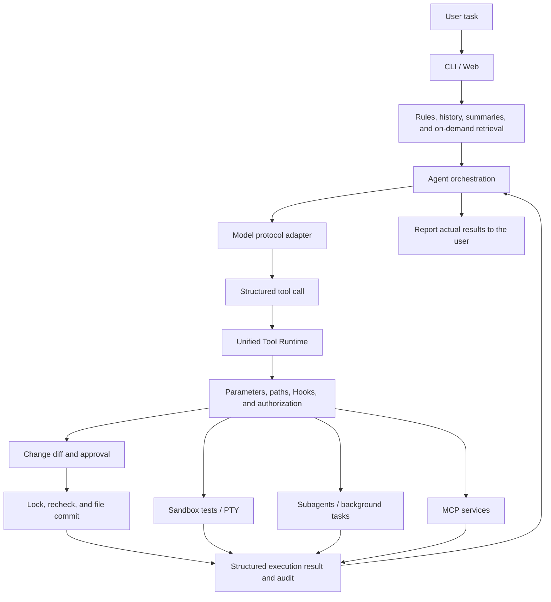

# Local AI Harness

**An execution framework for an AI coding assistant with a CLI and local web workbench.**

[中文](README.md) · English

Local AI Harness connects model integration, tool calls, code change review, sandbox validation, and task management in a traceable development workflow. Models propose actions; the client validates, authorizes, executes, and records the results.

Current version: **0.2.0**. The primary validation environment is **Linux / WSL with Python 3.12**.

## Core Capabilities

| Module | Implementation |
|---|---|
| CLI and Web | Terminal completion, file selection and attachments; web sessions, SSE streaming events, Markdown, code copying, approvals, and a task panel |
| Model protocols | OpenAI-compatible Chat Completions; streamed tool-argument assembly, full-response validation, normalization to internal messages, and preservation of reasoning fields; retains an Ollama protocol adapter |
| Unified Tool Runtime | Tool registration, JSON Schema parameter validation, path boundaries, approvals, Hooks, structured results, and auditing |
| File changes | File reading and code search; exact text replacement, merged multi-file diffs, conflict checks, atomic replacement for single files, and compensation after batch failures |
| Sandbox and PTY | Read-only projects and network-disabled execution with Bubblewrap; PTY interaction, output capture, timeouts, resource limits, and process-group cleanup |
| Writable subagents | Separate processes and task contexts; modify, create, test, and use PTYs through the unified Runtime; independent approvals and result reporting |
| Sessions and context | Multi-session history, trimming of complete tool chains, automatic or manual summaries; web checkpoints, approval pauses and resumption, and deduplication of completed tools |
| RAG and long-term memory | Chunking, incremental indexing, and hybrid retrieval using LangChain components; the web app provides explicit, editable long-term memory saved per workspace |
| Extension mechanisms | stdio MCP tool discovery and invocation, AGENTS.md, Skills, Skill draft generation, and trusted local Hooks |
| Git and diagnostics | Web workspace snapshots, diffs, single-file restore with conflict checks; structured error diagnosis and offline environment checks |

Default retrieval uses **term-feature hash vectors and keyword matching**. Remote semantic embeddings require explicit configuration and have not yet been tested against a real service.

## How a Development Task Runs



The CLI uses a bounded Python tool loop; the web app uses LangGraph orchestration and checkpoints. Both entry points share the model adapter, tool registry, execution permissions, and task foundation.

## Key Design

### Unified Execution Boundary

The model can submit only tool names and parameters. The program determines whether a tool exists, its parameters are valid, a path is accessible, and an operation is authorized. Model replies, file contents, retrieved material, and text returned by MCP cannot serve as authorization.

The web path also uses four layers of safeguards: input checks, model-response validation, tool-execution boundaries, and result constraints. Heuristic prompt-injection indicators and sensitive-content detection assist with evaluation; actual operations remain subject to the Runtime's hard rules.

### Reviewable Multi-file Changes

`apply_changes` preflights all related files as a batch, generates a combined diff, obtains one approval, then acquires the shared workspace lock and rechecks file contents and target paths. Existing files are modified using uniquely matched text snippets; new files are created from their complete contents.

A single file is written using atomic replacement or exclusive creation. If a batch commit encounters a recoverable failure, the system attempts compensation in reverse order and reports any paths it could not restore.

Files in a batch are committed one by one. **Atomic visibility across files and rollback after forced process termination are not guaranteed.**

### Tasks That Remain Interactive

The model can start a PTY, discover tasks, read output, send input, wait, and cancel; users can also take over from the task panel. Subagents have independent contexts and use the same tools for change approval and sandbox testing.

The web app's persistent task host lets tasks continue across requests and approval waits within the same session. After a service restart, it retains task records and marks unfinished tasks as interrupted; it does not automatically resume or rerun old processes.

## Quick Start

Python 3.12+ is required. Sandbox tests and PTY require Linux / WSL, the system `bubblewrap` package, and working namespace support. Git and Chromium are used for optional Git features and browser tools, respectively.

```bash
git clone https://github.com/CatoNeneko/my_local_cli.git
cd my_local_cli

# Create the project environment and install the command entry point.
mamba env create --prefix ./.conda-env --file environment.yml
mamba activate ./.conda-env
python -m pip install .

ai-cli --version
ai-cli --doctor --json
```

You can also install the project in an existing Python 3.12+ virtual environment. `--doctor` performs offline static checks only and does not request a model; finding `bwrap` does not mean the sandbox has run successfully.

### Configure a Model Service

See [config.example.toml](config.example.toml). Save the configuration to `~/.config/local-ai-cli/config.toml`, or use `--config` to specify a trusted file explicitly:

```toml
[model]
provider = "openai"
name = "your-model-id"
base_url = "https://your-provider.example/v1"
api_key_env = "OPENAI_API_KEY"
stream = true

[runtime]
approval_mode = "manual"
mcp_enabled = false
```

Provide the actual secret through the `OPENAI_API_KEY` environment variable in the launching terminal; do not put it in TOML. Configuration precedence is: **defaults → trusted user TOML → environment variables → explicit CLI arguments**. The program does not automatically load startup TOML files from the workspace.

The default model name is empty, approval is manual, and MCP is disabled; a local model will not start automatically. See the [user guide](docs/PRODUCT_UPGRADE.md) for configuration fields and automatic review rules.

See the [DeepSeek integration and live acceptance record](docs/DEEPSEEK.md) for the verified configuration and real API acceptance scope.

### Start the CLI or Web App

```bash
# CLI: the working directory is separate from the assistant's installation directory.
ai-cli --config /path/to/config.toml -C /path/to/project --session work

# Web: -C specifies the workspace root that the service may access.
ai-cli-web --config /path/to/config.toml -C /path/to/projects --port 8000
```

The web app is available at `http://127.0.0.1:8000`. Without a configured model, you can still manage sessions, browse files, build an index, and maintain memory.

You can start with a task like this:

```text
Read the calculation module and existing tests, find the addition bug, show the change diff, then fix it and run the tests after approval.
```

## Project Structure

| Code | Responsibility |
|---|---|
| `cli.py`, `script.py`, `web/app.py`, `web/static/` | Command line, HTTP API, and web interface |
| `agent.py`, `web/workflow.py`, `subagent_worker.py` | Agent loop, graph orchestration, and independent subagents |
| `model_client.py`, `api_adapter.py`, `streaming.py` | Model requests, protocol adaptation, and streaming collection |
| `tool_registry.py`, `tool_runtime.py`, `approval.py` | Tool declarations, shared execution entry point, and approvals |
| `harness/configuration.py`, `harness/diagnostics.py` | Unified configuration and offline checks |
| `harness/files/`, `harness/infrastructure/` | Multi-file changes and shared workspace lock |
| `harness/tasks/`, `web/task_service.py`, `web/task_host.py` | Process driver, task identity, persistent approvals, and task host |
| `context_window.py`, `compaction.py`, `web/knowledge.py` | Context budget, summaries, retrieval, and explicit memory |

## Validation

The latest local sandbox regression for version 0.2.0 reports **509 passed, 33 skipped**. Skipped tests were not counted as passed, and this result does not mean that all operating systems or model services have been validated.

Additional acceptance checks passed using fixed protocol fixtures:

- The full flow from browser to worker, diff approval, file commit, and sandbox testing.
- Writable subagent approval, rejection, conflicts, cancellation, and session isolation.
- Multi-file changes are not written before approval; after approval, they are committed with existing tests unchanged.
- Markdown, safe text rendering, drafts, input methods, and streaming event updates.
- Building a wheel offline, installing it in a temporary environment, and running it outside the source directory.

These checks actually execute the client, processes, file operations, and test sandbox; model output comes from fixed protocol fixtures on the local machine.

A separate live integration run against the official DeepSeek API found `deepseek-flash` and `deepseek-v4-pro` at `/models`, and selected `deepseek-flash`. All seven latest workflow acceptance checks passed. This verifies the specified DeepSeek model and the covered flows only; compatibility with other providers and remote semantic embeddings remains unverified. See the [DeepSeek integration and live acceptance record](docs/DEEPSEEK.md) for details and [GitHub Actions](https://github.com/CatoNeneko/my_local_cli/actions) for remote checks on each commit.

Development checks:

```bash
python -m pip install -r requirements-dev.txt
ruff check .
ruff format --check .
```

Local feature tests use the existing `run_tests` sandbox entry point; full steps and results are in the [acceptance record](docs/RELEASE_VALIDATION.md). The CI configuration is at `.github/workflows/tests.yml`; passing locally does not mean remote CI has passed.

## Current Boundaries

- Intended for local single-user use; the web app listens only on loopback. Public multi-tenant authentication and resource isolation are not implemented.
- Bubblewrap still shares the host kernel. Per-process resource limits are in place, but there is no aggregate cgroup quota or complete seccomp policy.
- MCP services and subagent Python workers are not themselves inside the test sandbox; stdio MCP does not include full support for HTTP transport, resources, or prompts.
- Default retrieval is not a semantic model; long-term memory consists of explicit workspace records; context budgets are estimated by character count.
- Multi-file changes do not yet have a crash-recovery log; background tasks do not automatically resume processes after a service restart.

## Documentation

- [Architecture and execution flow](docs/ARCHITECTURE.md)
- [Installation, configuration, and multi-file changes](docs/PRODUCT_UPGRADE.md)
- [Web, RAG, long-term memory, and recovery](docs/WORKBENCH.md)
- [Approval mechanism](docs/APPROVAL.md)
- [Context compaction](docs/COMPACTION.md)
- [Browser and MCP](docs/BROWSER.md)
- [Acceptance record](docs/RELEASE_VALIDATION.md)
- [Source code learning guide](docs/learning/README.md)

