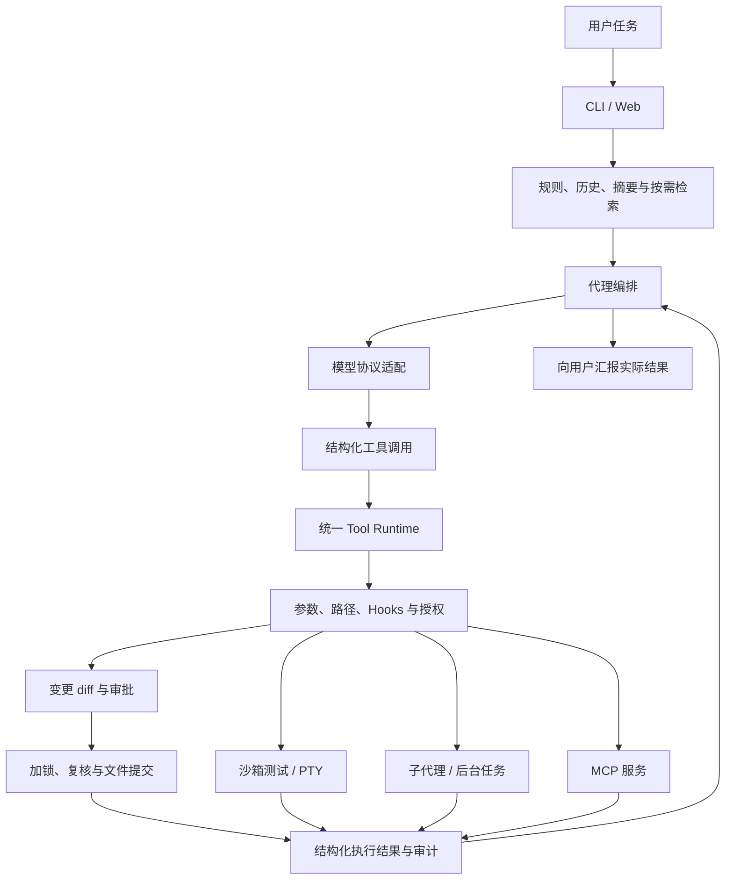

# Local AI Harness

**带 CLI 与本地 Web 工作台的 AI 编程助手执行框架。**

中文 · [English](README.en.md)

Local AI Harness 将模型接入、工具调用、代码修改审阅、沙箱验证和任务管理串成可追踪的开发流程。模型负责提出操作，客户端负责校验、授权、执行和保存结果。

当前版本：**0.2.0**。主要验证环境为 **Linux / WSL、Python 3.12**。

## 核心能力

| 模块 | 实现内容 |
|---|---|
| CLI 与 Web | 终端补全、文件选择与附件；Web 会话、SSE 流式事件、Markdown、代码复制、审批和任务面板 |
| 模型协议 | OpenAI 兼容 Chat Completions；流式工具参数组装、完整响应验证、内部消息规范化与推理内容字段保留；保留 Ollama 协议适配 |
| 统一工具 Runtime | 工具注册、JSON Schema 参数校验、路径边界、审批、Hooks、结构化结果和审计 |
| 文件修改 | 文件读取与代码搜索；精确文字替换、多文件合并 diff、冲突检查、单文件原子替换与批量失败补偿 |
| 沙箱与 PTY | Bubblewrap 只读项目、禁网执行；PTY 交互、输出采集、超时、资源限制和进程组清理 |
| 可写子代理 | 独立进程与任务上下文；经统一 Runtime 修改、新建、测试和使用 PTY；独立审批与结果回传 |
| 会话与上下文 | 多会话历史、完整工具链裁剪、自动/手动摘要；Web 检查点、审批暂停与恢复、已完成工具去重 |
| RAG 与长期记忆 | 基于 LangChain 组件分块、增量索引与混合检索；Web 提供按工作区保存、可编辑的显式长期记忆 |
| 扩展机制 | stdio MCP 工具发现与调用、AGENTS.md、Skills、Skill 草稿生成和可信本地 Hooks |
| Git 与诊断 | Web 工作区快照、diff、带冲突检查的单文件恢复；结构化错误诊断和离线环境检查 |

默认检索使用**词项特征哈希向量与关键词匹配**。远程语义 Embedding 需要显式配置，尚未完成真实服务联测。

## 一次开发任务如何执行



CLI 使用有界 Python 工具循环；Web 使用 LangGraph 编排与检查点。两个入口复用模型适配器、工具注册表、执行权限和任务基础层。

## 关键设计

### 统一执行边界

模型只能提交工具名称和参数。工具是否存在、参数是否合法、路径能否访问、操作是否获准，由程序判断。模型回复、文件内容、检索资料及 MCP 返回文字都不能充当授权。

Web 路径还按输入检查、模型响应校验、工具执行边界和结果约束组织四层护栏。启发式注入提示与敏感内容识别用于辅助判断；实际操作仍受 Runtime 的硬规则限制。

### 可审阅的多文件变更

`apply_changes` 对相关文件先整批预检，生成合并 diff，经一次审批后取得共享工作区锁，再复核文件内容与目标路径。已有文件通过唯一匹配的文字片段修改，新文件通过完整内容创建。

单文件使用原子替换或独占创建；批量提交发生可捕获失败时尝试逆序补偿，并报告未能恢复的路径。多个文件逐一提交，**不保证跨文件原子可见性或进程强杀后的回滚**。

### 可继续交互的任务

模型可启动 PTY、发现任务、读取输出、发送输入、等待和取消；用户也可在任务面板接管。子代理有独立上下文，并使用同一套修改审批与沙箱测试工具。

Web 的常驻任务宿主允许任务跨同一会话的请求和审批等待继续运行。服务重启后保留记录并标记未完成任务为中断，不自动恢复或重跑旧进程。

## 快速开始

需要 Python 3.12+；沙箱测试和 PTY 需要 Linux / WSL、系统 `bubblewrap`，以及可用的 namespace 支持。Git 和 Chromium 分别用于可选的 Git 功能和浏览器工具。

```bash
git clone https://github.com/CatoNeneko/my_local_cli.git
cd my_local_cli

# 创建项目环境，然后安装命令入口。
mamba env create --prefix ./.conda-env --file environment.yml
mamba activate ./.conda-env
python -m pip install .

ai-cli --version
ai-cli --doctor --json
```

也可将项目安装到已有的 Python 3.12+ 虚拟环境。`--doctor` 只做离线静态检查，不请求模型；找到 `bwrap` 不等于沙箱已实际运行成功。

### 配置模型服务

参考 [config.example.toml](config.example.toml)，将配置保存到 `~/.config/local-ai-cli/config.toml`，或用 `--config` 显式指定可信文件：

```toml
[model]
provider = "openai"
name = "your-model-id"
base_url = "https://your-provider.example/v1"
api_key_env = "OPENAI_API_KEY"
stream = true

[runtime]
approval_mode = "manual"
mcp_enabled = false
```

实际密钥通过启动终端的 `OPENAI_API_KEY` 环境变量提供，不写入 TOML。配置优先级为：**默认值 → 可信用户 TOML → 环境变量 → 显式 CLI 参数**。程序不会自动加载工作区中的启动 TOML。

默认模型名称为空、人工审批、MCP 关闭，不会自动启动本地模型。配置字段与自动审查规则见[使用指南](docs/PRODUCT_UPGRADE.md)。

DeepSeek 的已验证配置与真实 API 验收范围见 [DeepSeek 接入与实测记录](docs/DEEPSEEK.md)。

### 启动 CLI 或 Web

```bash
# CLI：工作目录与助手安装目录分离。
ai-cli --config /path/to/config.toml -C /path/to/project --session work

# Web：-C 指定服务允许访问的工作区根目录。
ai-cli-web --config /path/to/config.toml -C /path/to/projects --port 8000
```

Web 地址为 `http://127.0.0.1:8000`。未配置模型时仍可管理会话、浏览文件、建立索引和维护记忆。

可以从以下任务开始：

```text
读取计算模块和现有测试，定位加法错误，展示修改 diff，批准后修复并运行测试。
```

## 项目组织

| 代码 | 职责 |
|---|---|
| `cli.py`、`script.py`、`web/app.py`、`web/static/` | 命令行、HTTP API 与 Web 界面 |
| `agent.py`、`web/workflow.py`、`subagent_worker.py` | 代理循环、图编排与独立子代理 |
| `model_client.py`、`api_adapter.py`、`streaming.py` | 模型请求、协议适配与流式收集 |
| `tool_registry.py`、`tool_runtime.py`、`approval.py` | 工具声明、共享执行入口与审批 |
| `harness/configuration.py`、`harness/diagnostics.py` | 统一配置与离线检查 |
| `harness/files/`、`harness/infrastructure/` | 多文件变更与共享工作区锁 |
| `harness/tasks/`、`web/task_service.py`、`web/task_host.py` | 进程驱动、任务身份、持久审批与任务宿主 |
| `context_window.py`、`compaction.py`、`web/knowledge.py` | 上下文预算、摘要、检索与显式记忆 |

## 验证

0.2.0 最新本机沙箱回归：**509 项通过、33 项跳过**。跳过项没有计为通过，结果也不代表所有操作系统或模型服务均已验证。

额外通过的固定协议夹具验收包括：

- 浏览器到 worker、diff 审批、文件提交与沙箱测试的完整流程。
- 可写子代理的批准、拒绝、冲突、取消及会话隔离。
- 多文件变更批准前不写入，批准后提交并保持原测试不变。
- Markdown、安全文本呈现、草稿、输入法及流式事件更新。
- 离线构建 wheel，在临时环境中安装并离开源码目录运行。

这些验收实际执行客户端、进程、文件操作和测试沙箱，模型输出使用本机固定协议夹具。

另完成 DeepSeek 官方 API 的真实联测：`/models` 返回 `deepseek-flash` 与 `deepseek-v4-pro`，本轮选用 `deepseek-flash`，最新七项工作流验收全部通过。此结果只验证指定 DeepSeek 模型和本轮覆盖的流程；其他 provider 与远程语义 Embedding 仍待验证。详细范围见 [DeepSeek 接入与实测记录](docs/DEEPSEEK.md)，远端检查以 [GitHub Actions](https://github.com/CatoNeneko/my_local_cli/actions) 对应提交为准。

开发检查：

```bash
python -m pip install -r requirements-dev.txt
ruff check .
ruff format --check .
```

本地功能测试使用现有 `run_tests` 沙箱入口；完整步骤与结果见[验收记录](docs/RELEASE_VALIDATION.md)。CI 配置位于 `.github/workflows/tests.yml`，本机通过不等同于远端 CI 通过。

## 当前边界

- 面向本地单用户使用，Web 仅监听 loopback；未实现公网多租户认证与资源隔离。
- Bubblewrap 仍共享宿主内核；当前有每进程资源限制，尚无 cgroup 聚合配额或完整 seccomp 策略。
- MCP 服务和子代理 Python worker 本身不在测试沙箱内；stdio MCP 不包含 HTTP transport、resources 或 prompts 的完整支持。
- 默认检索不是语义模型；长期记忆为显式工作区记录；上下文预算按字符估算。
- 多文件变更尚无崩溃恢复日志；后台任务不会在服务重启后自动恢复进程。

## 文档

- [架构与执行流程](docs/ARCHITECTURE.md)
- [安装、配置与多文件修改](docs/PRODUCT_UPGRADE.md)
- [Web、RAG、长期记忆与恢复](docs/WORKBENCH.md)
- [审批机制](docs/APPROVAL.md)
- [上下文压缩](docs/COMPACTION.md)
- [浏览器与 MCP](docs/BROWSER.md)
- [验收记录](docs/RELEASE_VALIDATION.md)
- [源码学习导航](docs/learning/README.md)
