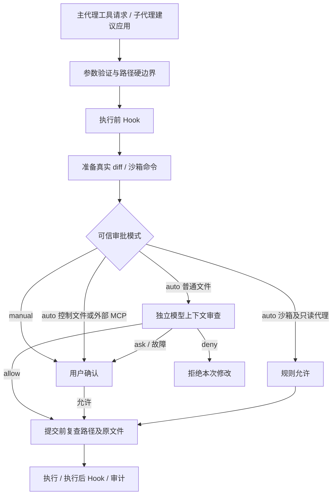

# 审批设计与代码阅读

执行入口始终是 `tool_runtime.execute_tool`。模型只选择工具并提供参数，不能提交 `approved`、`source` 或策略开关；JSON Schema 拒绝这些额外字段。

阅读顺序：`config.py` → `approval.py` → `permissions.py` → `tool_runtime.py` → `patches.py` → `audit.py`。子代理再读 `subagent_worker.py`、`agent_proposals.py` 和 `process_tasks.py`。

`task_scope` 用 `ContextVar` 保存可信调用方提供的当前用户任务。作用域退出时恢复原值，独立请求不会拿到整份聊天历史。它不是授权证明；真正权限仍由客户端控制。

`decision_scope` 为每次工具调用收集审批记录。规则、独立审查、人工确认都能记录；嵌套调用独立收集，子代理建议应用和内部实际写入各有对应事件。

`prepared` 是工具准备阶段的快照：文件工具包含原始字节、新字节及 diff；测试和 PTY 包含经过检查的命令及限制。审批不调用执行函数。文件写入时比较原始字节，避免批准的是旧 diff、写入的却是新目标。

`request_hash` 对用户任务、工具、目标和 diff 的 JSON 做 SHA-256，绑定本次审查内容。日志仅存摘要和固定原因代码，不重复存源代码。它不是数字签名，也不能让可修改的日志具备防篡改能力。

`PROPOSALS` 是子代理工作进程内的暂存列表；父进程只展示 ID、操作和目标。应用时内部读取完整建议，再走普通 `edit_file` / `create_file` 路径。子代理提出编辑时记录原文件 SHA-256，文件在等待期间变化会拒绝。

主代理负责选择要应用的建议；独立审查器负责对主代理及子代理建议采用相同标准；客户端负责最终是否调用写入函数。所谓“自动审查自己的权限”在这里是独立上下文检查主代理请求，同一个行动上下文不会自行签发放行结果。

限制：使用同一模型的独立上下文，并非独立模型提供商；审查器可能误判或受到注入影响。硬边界与沙箱必须始终存在。没有自动宿主命令、外部服务自动授权、提权、永久授权学习、跨进程任务恢复和多文件原子事务。

审查明确拒绝后，用户可以用 `/approval manual` 切换到人工模式，再申请同一建议；硬性路径与助手自身代码保护仍然生效。模型不能通过工具参数更改模式。
