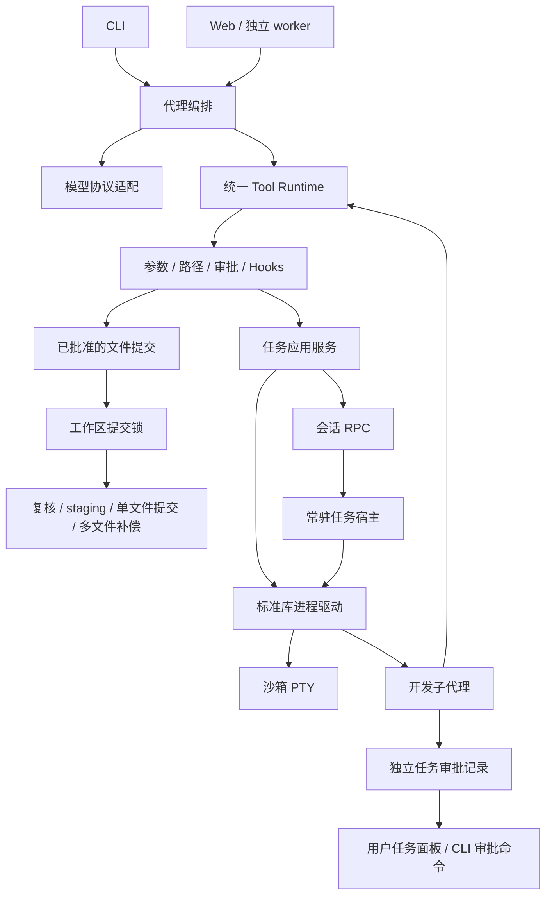
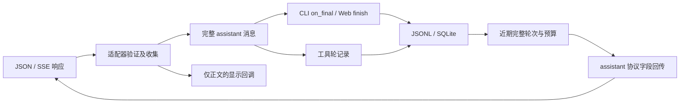

# 当前 Harness 架构与重构说明

这份文档对应 0.2.0 的实现。CLI 与 Web 共用启动配置和工具执行边界；前端不执行模型生成的代码，模型提出调用，Runtime 验证、审批并执行。模块按照职责分层，而不是按所用框架拆成互不相通的两套助手。安装和操作示例见 [PRODUCT_UPGRADE.md](PRODUCT_UPGRADE.md)。

## 分层与文件

| 层 | 文件 | 负责什么 |
|---|---|---|
| 交互入口 | `cli.py`、`script.py`、`web/app.py`、`web/static/` | 参数、命令、HTTP、SSE、任务和审批界面 |
| 统一配置和启动诊断 | `harness/configuration.py`、`harness/diagnostics.py` | 用户 TOML、环境变量、显式参数、类型和 URL 校验、只读 doctor |
| 代理编排 | `agent.py`、`web/workflow.py`、`web/worker.py`、`subagent_worker.py` | 模型与工具循环、预算、检查点、独立子代理上下文 |
| 模型协议边界 | `model_client.py`、`api_adapter.py`、`streaming.py` | 请求、流式收集、完整响应验证及内部格式转换 |
| 工具边界 | `tool_registry.py`、`tool_runtime.py` | 唯一工具声明、Schema、准备、权限、Hooks、执行、结果和审计 |
| 权限与文件提交 | `permissions.py`、`approval.py`、`patches.py`、`new_files.py`、`harness/files/changesets.py` | 硬边界、独立审查或人工确认、diff、单文件提交和多文件失败补偿 |
| 任务应用服务 | `harness/tasks/runtime.py` | 选择本地进程或会话 RPC、准备 PTY、启动子代理、绑定审批生命周期 |
| 进程驱动 | `harness/tasks/processes.py` | Popen、PTY、输出收集、时间和输出上限、取消、进程组清理；只依赖标准库 |
| 任务持久审批 | `harness/tasks/approvals.py` | 任务令牌验证、固定审批请求、一次性决定与消费、取消撤销 |
| 共享基础设施 | `harness/infrastructure/workspace_locks.py`、`sandbox.py` | 工作区提交互斥、Bubblewrap 和资源硬限制 |
| Web 任务宿主 | `web/runner.py`、`web/task_service.py`、`web/task_host.py` | 有界运行调度、worker 生命周期、常驻任务与会话 RPC |
| 会话和恢复 | `history.py`、`sessions.py`、`web/store.py`、`web/recovery.py` | 完整记录、会话隔离、持久审批、已完成工具去重与恢复 |
| 上下文和知识 | `context_window.py`、`compaction.py`、`web/prompts.py`、`web/knowledge.py` | 预算、摘要、来源、检索、增量向量复用及显式记忆 |
| 扩展和诊断 | `mcp_*`、`skills.py`、`hooks.py`、`project_instructions.py`、`web/diagnostics.py` | 外部工具、软规则、可信回调和受限诊断 |

## 安装目录、工作区与配置

`pyproject.toml` 使用 setuptools 构建 `local-ai-cli`，提供 `ai-cli = cli:main` 与 `ai-cli-web = web.__main__:main` 两个入口。根目录运行模块使用显式 `py-modules` 清单；包发现只包含 `harness`、`web`、`mcp_servers` 及其子包。Web 的 HTML、JavaScript、CSS 作为包资源进入 wheel，`demo.py`、测试和本机历史不进入运行模块清单。源码归档由 `scripts/package_project.py` 的独立白名单生成，包含开发文档和测试，不能把源码归档与 wheel 的用途混为一谈。

`workspace.APP_ROOT` 来自安装的 `workspace.py` 位置，表示助手自身程序目录；`permissions.PROJECT_ROOT` 表示本次处理的项目。CLI 的 `-C` 和 Web 的会话工作区改变后者，不改变前者。wheel 安装后 `APP_ROOT` 通常位于解释器的 `site-packages`，不要求用户把项目复制到安装目录。外部工作区的历史、审计、会话和锁放在其 `.ai-cli` 私有目录，安装程序与项目数据分离。助手文件工具仍禁止改写自身运行代码，不能通过切换工作区解除这一硬边界。

`AppConfiguration` 是冻结 dataclass：构造完成后字段不能被随意赋值，CLI 和 Web 从同一加载器获得启动快照。优先级从低到高为内置默认值、可信用户 TOML、`AI_CLI_*` 环境变量、显式 CLI 参数；未传的参数保持 `None`，不覆盖前层。默认用户文件为 `~/.config/local-ai-cli/config.toml`，`XDG_CONFIG_HOME` 可改变用户配置目录；`AI_CLI_CONFIG` 或 `--config` 可显式选择文件，后者优先。不会扫描当前项目的 TOML 来执行启动配置。项目 `AGENTS.md` 的软规则加载是另一条路径，不能修改可信启动参数或提供授权。

默认值为 `provider=openai`、空模型名称、`https://api.openai.com/v1`、密钥环境变量名 `OPENAI_API_KEY`、`stream=true`、`approval_mode=manual`、`mcp_enabled=false`。Web 默认两个 worker、单次执行片段超时 600 秒。普通 CLI 启动缺少模型时先报配置错误；帮助、版本、配置预览和 doctor 不要求先调用模型。默认配置不会启动本地推理或 MCP。

TOML 仅接受 `[model]`、`[runtime]`、`[web]` 的已声明字段，不能保存 API 密钥；类型错误、未知字段、非法服务地址直接报错。服务地址必须为 HTTP(S)，不能包含用户密码、查询参数、片段或控制字符；配置错误不会原样回显这些值。`model_settings()` 只生成协议、模型名、地址、密钥环境变量名和流式开关的字典，客户端需要时才读取密钥。

doctor 检查 Python、解释器、工作目录、模型和密钥配置是否存在、`bwrap`/Git 是否可找到、PTY 和必要模块是否可发现。它不执行 shell、启动 MCP、请求模型或实际运行 Bubblewrap。因此 doctor 的通过只描述静态检查，不能证明宿主允许用户命名空间、沙箱能启动或外部 API 可用。

## 执行关系



`TASK_BACKEND` 只负责选路。CLI 没有绑定 RPC 时使用本地进程驱动；Web worker 和 Web 子代理绑定带会话身份的 `TaskClient`。宿主不绑定客户端，执行本地驱动，避免 RPC 递归。它再次检查任务归属和活动身份，不把模型文字当成授权。

## 模型协议元数据和最终消息保存

`api_adapter.normalize` 将兼容接口的回复转换为内部消息，`collect_sse` 先拼接流式正文、工具参数及可选的 `reasoning_content`，完整结束后再验证消息。这个字段是模型服务要求回传的字符串元数据，不是工具调用、用户授权或界面正文；非字符串会被拒绝。SSE 的 `on_content` 回调只接收正文，不接收此字段。`wire_messages` 只在 assistant 消息中回传该字段，用户或工具消息不能冒充 assistant 提供它。

工具调用轮本来就保存完整 assistant 字典；最终回复之前只保留了字符串，容易丢失元数据。现在 `agent.run_agent` 仍返回供界面显示的正文，同时允许调用方提供 `on_final` 回调，接收完整最终消息。CLI 用它保存 JSONL，避免重复追加；Web 的 `finish` 节点把对应字段存入 SQLite，返回给界面的仍是正文。`on_final` 是函数参数：只有最终模型回复完成时才调用，用来把完整消息交给历史保存方；预算停止等程序提示继续走原来的文字分支。



OpenAI 兼容请求的字符预算通过转换后的消息计算，所以回传字段也占预算。摘要依然是有损文字，不能重建已省略的协议元数据；保留的工具轮不得拆开。`tests/test_reasoning_protocol.py` 使用人工构造的字段验证解析、流断开、完整历史、CLI/Web 保存及不向界面显示；[DeepSeek 实测](DEEPSEEK.md) 另外验证真实服务。原始联测只证实修复前字段会丢失，简单请求依然通过，没有观察到由此引起的 HTTP 400。

## 并发写入与审批

主代理和子代理都在 Runtime 内提交本地文件修改。准备和人工审批期间不持工作区锁，因此一个子代理等待用户审阅时不会锁住整个项目。批准后，在 `workspace/.ai-cli/locks/write.lock` 上取得互斥锁，执行器检查原文件是否变化，再提交；已变化则拒绝覆盖。Git 快照和恢复也使用同一把锁。

`apply_changes` 把一个有界批次作为一个工具调用：先检查全部路径、修改匹配、文件和 diff 大小，再展示合并 diff，随后进行一次审批。任何预检失败或用户拒绝都不会提交本批文件。批准后才取得写锁，比较旧内容并检查新路径，再把全部结果写入目标目录中的临时文件；落盘、设置权限后再次整批复核，逐文件提交前也再次复核。已有文件使用 `os.replace` 替换，新文件使用不覆盖现存目标的硬链接提交。

这里的 staging 指写入临时文件，不是 Git 暂存；commit 指文件系统提交，不是执行 `git commit`。可捕获的提交失败会逆序补偿已经写入的文件，但只补偿仍与本批新内容完全一致的目标，避免覆盖随后发生的外部修改。回滚失败路径放入 `rollback_errors`，需检查实际文件。共享锁只约束使用同一锁的应用写入，不能阻止外部编辑器写入。多个文件逐一可见，不是跨文件原子事务；强杀进程或断电不保证执行补偿。

子代理自己调用 `edit_file` / `create_file`，不再只能提交建议。手动模式的请求放入独立任务审批库，主运行结束后仍能审阅；批准只消费一次。取消任务或宿主重启会撤销尚未消费的授权。自动模式继续使用独立变更审查，不能决定时转人工。可选的建议工具仍可用于先讨论方案。

可写子代理也可调用 `apply_changes`。它将 Runtime 的 `show_diff` 接入当前待审批变更，把捕获的 diff 合并到该请求的审批详情，再交给任务审批库。新建文件与多文件修改因此也能在任务面板呈现实际变更；批准后仍重新检查内容和路径，不能把子代理回复中的“已批准”当成授权。

## Web 文本呈现边界

`web/static/markdown.js` 用 DOM API 创建标题、段落、列表、粗体、行内代码、围栏代码块与 HTTP(S) 链接；模型 HTML 作为文字显示，图片语法不会加载外部图片。代码和标签使用 `textContent`，不把模型文字交给 HTML 解释器；代码块的复制按钮调用浏览器剪贴板 API，并显示复制成功或失败。它是有界 Markdown 子集，不宣称支持完整 CommonMark 或执行代码。

会话筛选只匹配已加载会话的名称和工作区，不搜索历史消息。输入草稿按会话 ID 放在当前标签页的 `sessionStorage`，切换会话时分别保存和恢复，成功提交后清空，失败时保留。上次选中的会话 ID 存在 `localStorage`。这些浏览器状态不承担服务端持久会话或运行恢复；消息、审批与任务事件仍由 SQLite 保存。

PTY 首次启动按模式审批，之后 AI 可以发现任务、读取输出、发送输入、等待及取消；用户面板用于接管。同会话可继续使用任务 ID，其他会话不能访问。测试和 PTY 有每进程 rlimit、墙钟时间及输出上限；子代理 Python worker 本身不是 OS 沙箱。

## 清理了哪些旧路径

- 删除原 `process_tasks.py` 和 `task_approvals.py`，直接迁移全部调用到职责明确的任务包，没有保留兼容转发模块。
- 删除无人调用的 `model_client.generate_reply` 和冻结的 `tools.tool_definitions`；请求使用唯一 `request_message`，工具声明从注册表动态生成。
- 模型、编排及压缩模块直接依赖注册表和 Runtime，`tools.py` 仅保留用户文件操作的便利接口。
- 写锁从 Web 工作流移到共享基础层。子代理不会为了取得锁加载 LangGraph，锁只覆盖最终提交。
- 审批库实例随任务或宿主复用，状态查询不再重复初始化 SQLite、执行建表和修改目录权限。
- 输入和取消复用 Runtime 已获取的任务身份检查；宿主在真正执行请求时仍复核，去掉冗余预检 RPC 和不可达的旧自动审批分支。
- Web 监控先比较变化再查询和保存；已移出内存的任务同时清除宿主索引。CLI 保留最多 64 条近期任务结果，旧的完成记录可淘汰，不再因为累计启动 64 次而永久拒绝新任务。
- 沙箱运行环境取自当前解释器或显式参数，不再由服务构造时改写模块全局变量。
- 单轮上下文预算复用同一份工具声明，减少重复深拷贝；清理未使用导入并统一 Python 格式。

## 开发检查

开发依赖单独放在 `requirements-dev.txt`，安装到项目虚拟环境：

```bash
.conda-env/bin/python -m pip install -r requirements-dev.txt
.conda-env/bin/ruff check .
.conda-env/bin/ruff format --check .
```

GitHub CI 执行这两个静态检查和单元测试；本地改动由现有 `run_tests` 沙箱工具验收。`tests/test_task_runtime.py` 覆盖查询不重复初始化、权限查询次数、注册失败清理、基础层不加载编排、审批不持写锁和任务池持续使用。

浏览器和可写子代理夹具验收分别位于 `scripts/web_acceptance.py`、`scripts/writable_agent_acceptance.py`。它们使用实际进程、工具和审批，但模型输出由本机固定协议夹具提供。`scripts/live_api_acceptance.py --live` 另经用户授权使用 DeepSeek 官方模型完成七项联测，范围和原始失败重试见 [DeepSeek 实测](DEEPSEEK.md)；其他服务和远程语义 Embedding 仍待验证。静态检查和这些有限用例通过不等于没有任何缺陷。
