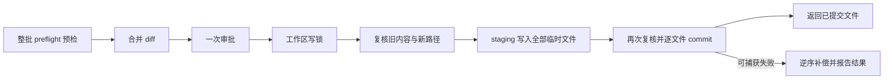

# 0.2.0 安装、配置与工具使用

当前版本把 CLI 与 Web 的模型启动配置放在同一加载器中，提供可安装的命令入口、只读环境诊断、多文件变更工具和安全 Markdown 界面。本文说明实际使用方法、代码入口及执行边界。

本轮实际执行的检查与局限见 [验收记录](RELEASE_VALIDATION.md)。

## 安装与程序入口

需要 Python 3.12 或更新版本。在源码目录中安装：

```bash
python -m pip install .
ai-cli --version
ai-cli --help
ai-cli-web --help
ai-cli-web --version
```

也可以先构建 wheel，再在另一 Python 环境安装该文件：

```bash
python -m pip wheel --no-deps --wheel-dir dist .
python -m pip install /path/to/local_ai_cli-0.2.0-py3-none-any.whl
```

第一条构建命令只生成本项目的 wheel，不同时构建运行依赖；第二条安装命令按包元数据安装依赖。完全离线时应提前准备依赖 wheel，并按本机包管理方式选择离线目录。开发依赖继续来自 `requirements-dev.txt`；Conda 的 `environment.yml` 保留 Python、pip，并引用 `requirements.txt`，不再维护第二套重复依赖版本。

`ai-cli` 对应 `cli:main`，`ai-cli-web` 对应 `web.__main__:main`。`python -m web` 与源码目录的 `python cli.py` 也可启动对应界面。Web 同样支持 `--config` 和 `-C`，例如 `ai-cli-web --config /path/to/config.toml -C /path/to/projects`。`--help` 和 `--version` 在加载配置、模型客户端和 MCP 之前退出，适合先确认入口是否安装正确。

安装目录由 `workspace.APP_ROOT` 定位；项目目录由 CLI 的 `-C` 或 Web 会话选择。安装后可在任意允许的项目目录工作，不必把业务代码放进 `site-packages`。外部项目的会话、历史、工具事件与锁存入该项目的 `.ai-cli`，Web 的服务数据库另外由 `AI_CLI_WEB_STATE` 定位。助手运行代码受写入硬边界保护；项目路径不能充当修改安装程序的授权。

## 配置优先级和默认值

同一个字段按下面的顺序覆盖：

1. 内置默认值。
2. 可信用户 TOML。
3. 对应的 `AI_CLI_*` 环境变量。
4. 显式 CLI 参数；未传的参数不覆盖前面的配置。

默认用户文件为 `~/.config/local-ai-cli/config.toml`，或者 `XDG_CONFIG_HOME/local-ai-cli/config.toml`。缺少默认文件时继续使用默认值；用 `AI_CLI_CONFIG` 或 `--config` 指定的文件缺失时会报错。`--config` 优先于 `AI_CLI_CONFIG`。应用不会从当前项目自动加载启动 TOML，因此打开陌生项目不会自动选择其模型地址或启用服务。

| 字段 | 默认值 | 环境变量 | CLI 覆盖 |
|---|---|---|---|
| 模型协议 | `openai` | `AI_CLI_PROVIDER` | `--provider` |
| 模型名称 | 空 | `AI_CLI_MODEL` | `--model` |
| 服务地址 | `https://api.openai.com/v1` | `AI_CLI_BASE_URL` | `--base-url` |
| 密钥环境变量名 | `OPENAI_API_KEY` | `AI_CLI_API_KEY_ENV` | `--api-key-env` |
| 流式响应 | `true` | `AI_CLI_STREAM` | 由用户配置或环境设置 |
| 审批模式 | `manual` | `AI_CLI_APPROVAL_MODE` | `--approval-mode` |
| MCP 启用 | `false` | `AI_CLI_MCP` | `--no-mcp` 强制关闭 |
| Web worker 数量 | `2` | `AI_CLI_MAX_WORKERS` | 由用户配置或环境设置 |
| Web 单次运行片段超时 | `600` 秒 | `AI_CLI_RUN_TIMEOUT` | 由用户配置或环境设置 |

布尔环境变量接受 `1`、`0`、`true`、`false`，大小写不敏感。Web worker 数量范围为 1–8，运行片段超时为 30–3600 秒。默认模型名为空；普通 CLI 启动会先要求配置模型，避免误发模型请求。默认值不启动本地推理，不启动 MCP。显式配置 `ollama` 是可用协议选项，不表示应用会自动安装、启动或恢复本地模型。

可信用户 TOML 示例：

```toml
[model]
provider = "openai"
name = "your-api-model"
base_url = "https://api.openai.com/v1"
api_key_env = "OPENAI_API_KEY"
stream = true

[runtime]
approval_mode = "manual"
mcp_enabled = false

[web]
max_workers = 2
run_timeout = 600
```

`api_key_env` 保存的是变量名，不能把密钥值填在这里，也不能添加 `api_key` 字段。真正的密钥由用户在启动 shell 中设置，客户端需要时读取。未知字段、错误类型和非法 URL 会被拒绝；服务地址只接受 HTTP(S)，拒绝用户密码、查询参数、片段和控制字符。错误信息不回显配置值。`web.env.example` 仅为示例文件，不会自动读取或执行。

`manual` 让文件写入和需要确认的执行操作进入人工审批。`auto` 可对受限普通变更调用独立风险审查，受控文件、超出范围或无法确定的请求仍需人工确认；模型建议或工具返回的文字不能代替授权。

DeepSeek 官方 API 使用同一兼容协议，设置 `name="deepseek-flash"`、`base_url="https://api.deepseek.com/v1"`、`api_key_env="DEEPSEEK_API_KEY"` 即可。配置和最新七项真实联测见 [DeepSeek 接入](DEEPSEEK.md)。密钥只放环境变量；联测脚本的隐藏输入仅供该脚本使用，CLI 本身不会弹出密钥输入提示。

CLI 示例：

```bash
ai-cli --config ~/.config/local-ai-cli/config.toml -C /home/yourname/projects/demo
ai-cli --model another-api-model --approval-mode manual --no-mcp -C /home/yourname/projects/demo
ai-cli --show-config
ai-cli --doctor --json -C /home/yourname/projects/demo
```

`--show-config` 输出合并后的字段，只显示密钥变量名，不读取或显示密钥内容。`--doctor` 可在空模型配置下运行，检查当前 Python、解释器、目录、配置存在性、Git、Bubblewrap、PTY 与可发现的模块。它不请求模型，不运行外部命令，也不试启沙箱。找到 `bwrap` 可执行文件并不能证明宿主允许其命名空间和挂载操作；实际 `run_tests` 或 PTY 执行结果才反映当前沙箱能否运行。诊断也不证明 API 地址可连接或密钥有效。

## 多文件变更工具

`apply_changes` 已接入 `tool_registry.py` 与统一 Runtime；模型、主代理和可写子代理使用同一参数验证、权限、Hooks、审批和审计入口。每批最多 10 个文件，不支持删除；`path` 使用当前项目根目录 `"."`，省略时也默认该值。

已有文件用 `edits` 描述准确替换，每个 `old_text` 必须非空并在当时内容中唯一匹配。新文件用 `content` 提供完整内容，不能用它覆盖已有文件。一个变更项必须二选一，不能同时提供两种内容。以下是工具调用参数，并非直接在 shell 中执行的命令：

```json
{
  "path": ".",
  "changes": [
    {
      "path": "src/greeting.py",
      "edits": [
        {
          "old_text": "def greeting():\n    return \"hello\"\n",
          "new_text": "def greeting(name):\n    return f\"hello {name}\"\n"
        }
      ]
    },
    {
      "path": "tests/test_greeting.py",
      "content": "from src.greeting import greeting\n\ndef test_greeting():\n    assert greeting(\"world\") == \"hello world\"\n"
    }
  ]
}
```

调用前应先读取已有文件，按实际内容填写 `old_text`。示例的 `name` 是传入的称呼，Python 的 `f"hello {name}"` 会把变量代入字符串；这段 Python 只是待写入的项目代码，审批界面和 Markdown 都不会执行它。

执行顺序是：



预检检查全部路径、符号链接、重叠路径、唯一匹配、文件内容和批次大小；单文件上限 1 MiB，整批新旧内容合计上限 2 MiB，合并 diff 上限 16000 字符。任一预检失败或拒绝审批，整批不写入。审批前不持工作区锁，避免等待审阅时阻塞其他任务。

批准后取得与主代理、子代理、Git 操作共用的写锁，重新确认审批期间文件未变、新文件仍不存在，然后在各目标目录写临时文件并落盘。再次检查全部目标后逐文件提交：已有文件使用替换，新文件通过不覆盖目标的方式创建。这里 staging 是临时文件准备，commit 是文件系统提交，不会操作 Git 索引或创建 Git 提交。

发生可捕获的 I/O、冲突或取消异常时，执行器尝试逆序恢复已提交的文件。只恢复仍等于本次新内容的文件；若已被外部修改则保留外部内容，将路径写入 `rollback_errors`。`rolled_back` 表示发生过提交且已完成补偿，不能只凭 `ok=false` 推断工作区毫无变化。应检查返回的 `changed`、回滚信息和实际内容，再决定下一步。

每个文件仍逐一提交，其他进程可能观察到中间状态。这不是跨文件原子事务；共享锁也不能锁住外部编辑器。进程被强杀、解释器异常终止或机器断电时不保证执行补偿，需重新读取工作区再恢复，不能盲目重放旧批准。

可写子代理能直接使用该工具，也保留 `edit_file`、`create_file` 和建议工具。子代理 worker 捕获 Runtime 生成的实际 diff，补入当前任务的审批详情；新文件和整批修改因此都能在任务面板审阅。授权仍绑定具体请求、只消费一次；批准后也必须复核，子代理不能继续派生代理。

## Web 阅读和会话操作

设置 `AI_CLI_WORKSPACE_ROOT` 后运行 `ai-cli-web --port 8000`，访问 `http://127.0.0.1:8000`。服务只监听本机 loopback；会话工作区必须位于允许根目录内。Web 默认模型为空时仍可管理会话、浏览文件、建立索引和管理显式记忆；提交模型任务需要配置模型及密钥环境变量。

Agent 回复中的标题、列表、粗体、行内代码和围栏代码块由 `web/static/markdown.js` 渲染。代码块带“复制代码”按钮，复制依赖浏览器剪贴板能力；失败时会显示失败状态。HTTP(S) 链接可以打开，原始 HTML 和图片语法保留为文字，代码标签、语言名与正文用文本节点呈现，不执行 HTML 或代码。这是有界的 Markdown 子集，复杂表格和嵌套格式不保证完整 CommonMark 效果。

左栏搜索只筛选会话名称和工作区，支持 `Ctrl/⌘+K` 聚焦、`Esc` 清空；不会搜索历史消息正文。上次选择的会话 ID 放在浏览器 `localStorage`。输入草稿按会话 ID 放在当前标签页的 `sessionStorage`，切换会话或刷新页面可恢复；成功提交后清空，失败时保留。草稿不写服务端，不跨设备同步，关闭标签页后不能依赖恢复。

输入框 `Enter` 发送、`Shift+Enter` 换行；中文输入法合成期间不发送。审批、任务输出、文件与 Git 面板沿用既有 Runtime 和后端边界。草稿及 Markdown 只改善呈现，不改变工具权限，也不构成持久运行恢复。有关图检查点、任务宿主和沙箱限制，见 [WORKBENCH.md](WORKBENCH.md)；代码分层见 [ARCHITECTURE.md](ARCHITECTURE.md)。

## 学习代码的顺序

先读 `cli.py` 如何把显式参数交给 `harness/configuration.py`，再看 `web/settings.py` 如何复用同一个不可变配置。随后读 `tool_registry.py` 的参数声明、`tool_runtime.py` 的准备与审批顺序，以及 `harness/files/changesets.py` 的复核和补偿。最后沿 `subagent_worker.py` 看任务审批 diff 如何保留，沿 `web/static/markdown.js` 和 `web/static/app.js` 看不可信文本如何呈现、会话状态如何隔离。

`tests/test_configuration.py`、`tests/test_distribution.py`、变更集与诊断测试表达相应行为的回归约束；浏览器验收脚本还包括 `scripts/ui_readability_acceptance.py`。当前完整沙箱回归为 508 passed、33 skipped，新增的协议和联测报告测试不请求模型。DeepSeek 官方 JSON/SSE、编码测试、审批、PTY、子代理和 Web 已完成独立真实联测；其他模型与语义 Embedding 仍待验证。测试代码、doctor 和实际执行验收承担不同职责；只有实际运行的结果才能作为该环境的验收证据。
