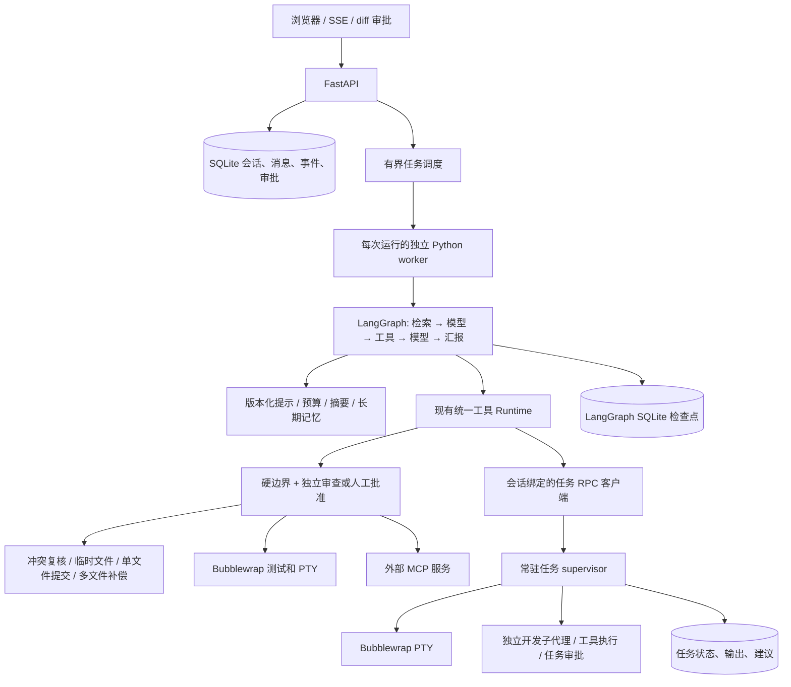

# Web 开发工作台

这是现有 CLI 核心上的本地单用户 Web 版本。前端为原生 HTML/CSS/JavaScript，后端为 FastAPI，LangGraph 编排工作流，LangChain 组件负责分块、Embedding 和提示模板。ReAct 指模型选择工具、观察结果再决策的循环，并不要求 React 前端框架，也不展示模型私有思维链。

## 启动

使用 Python 3.12 或更新版本。Linux/WSL 开发环境可继续使用 `.conda-env`；系统 Bubblewrap 不装进 Python 环境。先安装项目，再通过统一入口启动：

```bash
.conda-env/bin/python -m pip install .
export AI_CLI_WORKSPACE_ROOT=/home/yourname/projects
export AI_CLI_MODEL=your-api-model
export AI_CLI_BASE_URL=https://your-provider.example/v1
export OPENAI_API_KEY='在当前终端设置，勿提交'
.conda-env/bin/ai-cli-web --port 8000
```

已构建 wheel 也可以用当前环境的 `python -m pip install /path/to/local_ai_cli-0.2.0-py3-none-any.whl` 安装，再运行 `ai-cli-web --port 8000`。`python -m web --port 8000` 入口保留。安装过程会按元数据安装声明依赖；离线安装时需准备匹配的依赖 wheel。

打开 `http://127.0.0.1:8000`。`web.env.example` 为配置说明，不自动加载，不把密钥填到浏览器或聊天里。新会话只接受允许根目录下的真实 Linux 路径；Windows 文件使用 `/mnt/c/...` 路径，需在服务启动时允许对应根目录。默认监听 loopback，不提供公网绑定、多用户认证或生产部署承诺。

未配置模型也能管理会话、预览文件、索引、检索和管理长期记忆；提交 Agent 任务返回明确的 503。Web 仅配置兼容 API，不默认启动或调用 Ollama。真实 API 质量、延迟和费用需要自行配置后验证。

### 共用启动配置

Web 的 `Settings.from_env()` 复用 `harness/configuration.py`，配置优先级为默认值 < 用户 TOML < `AI_CLI_*` 环境变量。CLI 另有最后一层显式参数。默认模型协议是 OpenAI 兼容 API，模型名为空，审批模式为 `manual`，MCP 关闭，流式开启；默认地址为 `https://api.openai.com/v1`，只保存 `OPENAI_API_KEY` 这一密钥环境变量名。Web 的就绪检查仍要求模型名称及对应环境变量中的密钥。

默认只读取 `~/.config/local-ai-cli/config.toml`；设置 `XDG_CONFIG_HOME` 可改变用户目录，用 `AI_CLI_CONFIG` 可显式选择可信配置文件。不会自动读取会话项目的 `config.toml`。TOML 允许 `[model]`、`[runtime]`、`[web]` 中声明的字段；禁止密钥内容、未知字段与错误类型，模型 URL 禁止携带凭据、查询参数或片段。环境变量覆盖 TOML 的同名设置，布尔环境值接受 `1`、`0`、`true`、`false`。

`AI_CLI_WORKSPACE_ROOT` 是浏览器允许选择的项目根目录；`AI_CLI_WEB_STATE` 是服务私有状态目录。它们不改变安装目录。`workspace.APP_ROOT` 定位安装程序，项目路径独立绑定；从 wheel 启动时也不需要在源码仓库中创建会话。完整字段表、TOML 和工具 JSON 示例见 [PRODUCT_UPGRADE.md](PRODUCT_UPGRADE.md)。

可用 `ai-cli --doctor --json -C /home/yourname/projects` 进行只读环境诊断，用 `ai-cli --show-config` 查看合并配置。它们不请求模型、不启动 MCP，也不运行沙箱。doctor 找到 `bwrap` 不等于当前内核和宿主策略允许实际启动；测试及 PTY 仍须经过真实沙箱执行来确认。

### 阅读、复制与草稿

Agent 回复显示安全 Markdown 子集：标题、列表、粗体、行内代码、围栏代码块和 HTTP(S) 链接。代码块右上角可复制代码，剪贴板不可用或授权失败时显示失败。HTML 保持文本，图片语法保持文本；代码块不会执行。用户消息与工具历史保留文本显示，工具详情可展开查看。

左栏会话搜索按名称或工作区做大小写无关筛选；`Ctrl/⌘+K` 聚焦搜索框，`Esc` 清空筛选。输入框按会话分别保存草稿：切换会话和同一标签页刷新后可恢复，成功提交后清除，提交失败保留。草稿仅存当前浏览器标签页的 `sessionStorage`，不写入服务端、不跨设备同步；禁用浏览器存储时仍可使用当前页面，但不能依赖草稿恢复。`Enter` 发送，`Shift+Enter` 换行，输入法合成文字期间不会触发发送。

## 执行架构



`web/app.py` 提供 API、同源和目录边界。`web/runner.py` 限制并发、收集 worker JSONL 事件并持久化。`web/worker.py` 独立绑定项目，桥接浏览器审批与原权限入口。`web/workflow.py` 实现显式图和工具循环，普通失败继续、取消或预算耗尽补齐未执行结果。`web/store.py` 保存完整消息与有序事件。`web/knowledge.py` 保存检索索引和长期记忆。

### 并发和恢复

- 同会话一次只允许一个活动运行，不同会话有界并发；最多 32 个等待/运行任务，默认 2 个 worker。
- worker 隔离 CLI 的进程级可变路径、规则、MCP 注册和模型配置。同仓库的本地写操作另用文件锁串行；审批期间外部编辑仍由原文件比较检测。
- SSE 事件存数据库，刷新可以恢复活动运行和审批，通过 `Last-Event-ID` 续接。
- 文件审批使用 LangGraph `interrupt` 持久暂停，worker 退出并释放槽位；浏览器批准/拒绝后，重新建立 worker，用相同 run ID 和 `Command(resume=...)` 继续。服务重启保留已确认持久暂停的审批。
- 工具按单调用节点保存检查点，另有 `web/recovery.py` 副作用日志与消息批次去重。已记录完成的工具不重放；执行中崩溃、结果未确认的调用不当作“未发生”，不会直接重新执行。恢复时重新准备 diff 并核对旧批准的操作、目标和 diff 是否一致。
- 普通运行崩溃仍标为 interrupted。界面的“继续任务”会创建新任务，携带原目标与先核实实际状态的要求，不是自动重放旧图。不能宣称任意副作用 exactly-once。
- 取消主运行给 worker 发信号，关闭该 worker 的 MCP，再超时强制终止。已完成文件写入或外部操作不回滚。Web 的 PTY 和子代理归常驻任务服务管理，不随 worker 结束或审批暂停清理；取消后台任务需要单独操作。

MCP 服务启动确认发生在图外，仍使用运行期间的人工确认；图持久暂停覆盖图内的工具审批，不把 MCP 启动也宣称为无进程占用。运行超时限制每次 worker 执行片段；暂停期间不持续占用执行计时。SSE 连接在服务退出时最多等待 3 秒后关闭，避免持续事件连接阻塞重启。

### 常驻终端与子代理

`web/task_service.py` 提供服务生命周期和 RPC 客户端；`web/task_host.py` 持有真实进程及任务状态。`harness/tasks/runtime.py` 的 `TASK_BACKEND` 是上下文变量：Web worker 绑定客户端后转向 supervisor；CLI 未绑定时使用 `harness/tasks/processes.py` 驱动本地进程。任务仍经统一 Runtime 的参数、路径和审批检查，服务端再次检查会话归属、活动运行和启动参数。分层和重构细节见 [ARCHITECTURE.md](ARCHITECTURE.md)。

任务 ID 可用于同一会话之后的请求。主代理和子代理通过 `list_tasks` 发现任务，通过 `task_input`、`task_wait` 等工具完成交互；已拥有的 PTY 不逐次人工审批输入，首次启动仍按审批模式处理。浏览器面板可接管输入和取消，其他会话不能访问任务。输出按字节偏移分段读取，显示和保存均有上限。终端运行在只读项目、禁网、可写临时目录的 Bubblewrap 沙箱内。

子代理有独立上下文，能使用原 Runtime 修改、新建文件和执行测试。修改经过同一个路径边界、diff、审批及冲突检查，主/子代理最终提交在 Runtime 内使用同一把工作区锁，审批期间不持锁。`harness/tasks/approvals.py` 保存人工请求，任务卡片展示并批准或拒绝；授权绑定任务及具体请求，一次性消费，取消或宿主重启撤销未消费授权。父运行结束后子代理仍可继续审批和使用终端。子代理不能继续派生代理或直接调用 MCP，亦可选择只提交修改建议。它的可信 Python worker 未整体 OS 沙箱化，终端和测试才在沙箱执行。

子代理的可写工具还包括 `apply_changes`，可将已有文件精确替换和新文件完整内容放在同一批次。worker 捕获实际 diff，并附到任务审批请求中，任务面板据此展示变更。整批先预检再审批；批准后取得共享锁、复核原始状态、暂存全部新内容，再逐文件提交。可捕获失败会尝试补偿，外部再次修改的文件保持其现状并报告回滚问题；这不保证跨文件原子可见性，也不保证强杀后的回滚。示例及边界见 [PRODUCT_UPGRADE.md](PRODUCT_UPGRADE.md#多文件变更工具)。

测试与 PTY 在沙箱内的可信启动解释器先用 `resource.setrlimit` 设置硬上限，再 exec 目标程序：默认每进程 CPU 硬上限 60 秒（提前一秒发软限制信号）、虚拟地址空间 2 GiB、单文件 16 MiB、打开文件数 256，关闭 core dump；配置错误拒绝执行。限制由后代继承，设置失败没有宿主回退。它们不是 cgroup 的整个任务内存、总进程数或 `/tmp` 总容量配额，不能宣称能完整抵御 fork bomb。原有墙钟超时与输出限制继续生效。[Python resource 文档](https://docs.python.org/3/library/resource.html)说明了软、硬限制及各资源的含义。

后台服务与 worker 使用 Unix socket 和随机令牌通信，目录为 0700、令牌文件为 0600；这是本机用户范围的访问控制，不是针对同一 OS 用户恶意程序的隔离。启动进程由长期存活的调度线程执行，避免 Bubblewrap 的父线程退出信号误杀任务。

公开终端输出和子代理回复经过脱敏；私有 RPC 中用于路径匹配的字段及待审批源码保持精确，不通过对整段 JSON 文字替换来脱敏，避免误改合法路径或代码。

任务状态、有限输出和完成的子代理建议保存到 SQLite。服务关闭会清理它管理的进程；服务重启会把遗留运行状态标为 `interrupted`，不能恢复已消失的 PTY 进程，也不会自动重新执行任务。已完成结果可以查询，尚未应用的完整建议可以继续按原审批流程处理。普通 CLI 退出清理和任务不跨进程恢复的行为保持原样。

### 异常诊断

`web/diagnostics.py` 将异常转换为固定的 `code`、`title`、`message`、`suggestion`、`retryable` 和阶段字段，覆盖连接失败、超时、HTTP 状态、响应结构、上下文预算及本地读写失败。失败卡片显示原因和下一步建议；不会自动重试可能已经发生的副作用。

诊断保存到运行事件和私有 `diagnostics/<run_id>/events.jsonl`，独立日志有字段白名单、脱敏、大小限制与轮换。任意异常原文、HTTP 响应正文、密钥和完整请求不会作为诊断记录。独立日志不可写时仍尝试通过数据库完成失败状态，不承诺磁盘完全不可用时还能持久化。诊断分类不代表确定的根因。

## Git 变更与恢复

Git 面板提供工作区状态、已暂存/未暂存差异、任务前快照与手工快照。工作目录必须是有效 Git 仓库根目录，不会自动初始化仓库，也不会修改索引或 HEAD。

任务启动前对允许的文本文件保存实际工作区基线，因此已有未提交内容包含在快照中。快照保存于私有状态目录，跳过隐藏/敏感路径、符号链接和被忽略文件，并限制单文件、总量与文件数量。不是整个目录的完整备份。

恢复流程是选择快照和单文件 → 展示 diff 和当前哈希 → 用户明确允许 → 再次校验哈希 → 原子替换。预览后文件变化时拒绝覆盖。不会执行 `git reset --hard`、`clean` 或 `stash`，也不自动删除任务新建文件。恢复助手自身代码仍受到原硬边界限制。恢复后的测试状态要重新验证，不能继承恢复前的测试通过结论。

## RAG 与长期记忆

先在知识检索面板建立当前仓库索引。文本按 LangChain splitter 分块，保存路径、行号、文件哈希与向量；查询使用词项和向量的混合评分，结果带来源。重建索引会删除已移除文件的旧块，跳过私有目录、符号链接、非文本文件，并限制总读取量。

更新索引仍会扫描、读取和分块允许的文件，但会复用同项目、同文件 SHA-256、同 Embedding 签名以及相同路径/行号/文本块的向量。新增或修改文件重新计算向量，删除或本次不再纳入的文件清除旧索引；界面显示复用块、重新计算块和移除文件的数量。旧向量损坏或维度不一致时回退到本次全量向量化。向量化完成后才提交数据库事务，失败保留原索引。同一服务实例的更新串行；跨实例仍为最后一次事务写入生效。当前不是文件监听器或免扫描的大仓库索引。

默认 `HashTokenEmbeddings` 是确定性词项特征向量，不是训练得到的语义模型。配置 `AI_CLI_EMBEDDING_MODEL` 后可使用 LangChain 的兼容 API Embedding，代码不会自动下载或运行本地模型。索引记录 Embedding 配置签名，更换配置需要重建，不能混用不同向量空间。远程 Embedding 会把选定文本发送给服务，需由使用者明确配置。

长期记忆由用户显式保存，按项目隔离，支持查看、编辑和删除；记录来源及会话，不自动把模型猜测写成事实。跨同项目会话检索记忆，作为数据加入上下文，不能作为授权。当前没有用户级全局记忆、自动遗忘/TTL 或未经确认的经验自动提取。

## 提示工程与上下文工程

`web/prompts.py` 维护版本化主代理模板，原 CLI 保留独立审查、摘要和子代理提示。请求组合项目规则、有效摘要、近期完整用户轮次、带来源的检索片段和记忆；额外资料有自己的 7000 字符预算，最终请求再检查 64000 字符上限。字符预算不是精确 token 预算。

事件记录提示版本、检索来源、记忆 ID、发送量和省略量。原历史和摘要检查点留存，工具调用/结果不能随意拆开。检索结果是当时索引快照，真实编辑前仍须读取文件，不能把旧检索块当成最新文件。

## 四层护栏

这四层是项目采用的组织方式，不是行业统一标准：

| 层 | 实现 | 限制 |
|---|---|---|
| 输入 | 长度与 NUL 检查、疑似密钥拒绝、注入启发式警告 | 正则不能识别全部秘密或攻击 |
| 模型输出 | 完整协议、类型、工具调用批次、唯一 ID；Runtime 参数 Schema | 合法参数不证明目的合理 |
| 执行 | 统一 Runtime、项目边界、审批、冲突检查、只读禁网沙箱及每进程 rlimit | MCP 和子代理 worker 未整体 OS 沙箱化；没有 cgroup 总量配额 |
| 结果与记忆 | 标准状态、大小限制、敏感文字脱敏、来源、显式记忆写入 | 不能保证语义正确或完全免疫注入 |

浏览器 Markdown 通过 DOM 节点与 `textContent` 构造，代码、标签和原始 HTML 不执行；链接只允许 HTTP(S)。写接口限制同源，服务限制 Host 和可选项目根目录。当前仅适合本地单用户，仍不是生产级多租户不可信代码平台。

## 验证

`tests/test_web_*` 覆盖存储、审批一次性、项目隔离、索引删除更新、记忆、图检查点、结构错误不执行、任务进程、取消和 API 边界。`scripts/web_acceptance.py` 使用本机确定性协议夹具验证真实 worker 和浏览器流程，不调用真实模型，不代表真实模型成功率。用量账本不可写时保持缺失，不按零计算。

历史离线评估记录见 [EVALUATION.md](EVALUATION.md)。夹具、默认词项检索与单元测试不能证明真实模型成功率或语义 RAG 效果。本文描述当前功能和执行边界，不把历史记录作为当前版本的验收结果。

后续生产增强包括账户认证、跨机器任务队列、语义检索效果评估、向量数据库、文件监听与更大仓库的增量扫描、记忆有效期和更完整的沙箱资源限制。

LangGraph 中断恢复会重新运行被中断节点前部的代码，因此必须单独控制副作用，不能只添加检查点就承诺安全重试：[官方中断说明](https://docs.langchain.com/oss/python/langgraph/interrupts)。
