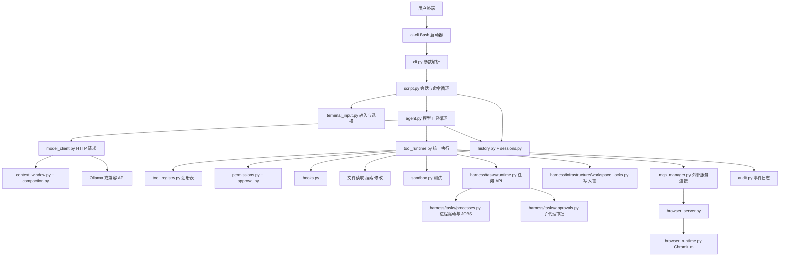

# 00：先把整个项目放进一张地图

## 1. 它不是四十多个独立程序

多数 `.py` 文件是可导入的模块。一个 Python 进程会导入这些文件，调用里面的函数。只有 CLI 启动入口、子代理 worker 和 MCP server 等明确的入口会作为独立进程运行。

图中箭头表示核心请求/控制关系，不代表每条导入关系。`model_client` 获得工具声明时也读取注册表；规则、Skills 在构造上下文时加入。

## 2. 功能模块与文件逐一对应

| 模块 | 文件 | 具体分工 |
| --- | --- | --- |
| 启动与配置 | `ai-cli`, `cli.py`, `config.py`, `workspace.py` | 固定解释器、解析参数、配置字典、绑定目标项目与状态路径 |
| 主交互 | `script.py`, `command_help.py` | `/` 命令分派、用户消息保存、代理调用、回答显示与退出 |
| 代理 | `agent.py` | 有限轮次请求、执行工具批次、补齐结果并再次请求 |
| 模型协议 | `model_client.py`, `streaming.py`, `api_adapter.py` | 唯一模型请求入口 `request_message`、HTTP、Ollama NDJSON、兼容 API 消息转换与 SSE |
| 输出 | `console_output.py`, `tool_display.py` | 流式回答去重、状态、diff、终端控制字符转义 |
| 会话记忆 | `history.py`, `sessions.py` | JSONL 加载追加、命名切换、重命名与导出 |
| 请求上下文 | `context_window.py`, `compaction.py` | 完整轮次裁剪、字符预算、摘要检查点与恢复 |
| 工具底座 | `tools.py`, `tool_registry.py`, `tool_runtime.py` | 兼容包装、工具声明、共享执行路径 |
| 权限与记录 | `permissions.py`, `approval.py`, `audit.py` | 路径边界、确认策略、独立 diff 审查、事件摘要 |
| 文件工具 | `file_tools.py`, `project_search.py` | 单文件读取搜索、列目录、有限递归正文搜索 |
| 文件写入 | `patches.py`, `new_files.py` | 全文件 diff、冲突检查、原子替换和独占新建 |
| MCP | `mcp_client.py`, `mcp_tools.py`, `mcp_manager.py` | 协议与参数、注册转换、常驻连接与生命周期 |
| 项目指导 | `project_instructions.py`, `skills.py` | 根 AGENTS 加载、Skills 发现与手动启用 |
| Skill 生成 | `skill_generation.py`, `skill_files.py` | 无工具生成草稿、审查与独占保存 |
| Hook | `hooks.py` | 执行前拒绝、执行后报告；传递数据快照 |
| 任务 API | `harness/tasks/runtime.py` | 通过 `TASK_BACKEND` 连接本地或会话任务后端，准备 PTY、启动子代理、检查/输入/等待/取消任务 |
| 进程驱动 | `harness/tasks/processes.py` | 纯标准库进程启动、`JOBS`、`launch`、输出采集与回收 |
| 子代理审批 | `harness/tasks/approvals.py` | `TaskApprovalStore` 保存待处理请求并提供一次性消费 |
| 工作区写锁 | `harness/infrastructure/workspace_locks.py` | 规范化工作区下 `.ai-cli/locks/write.lock` 跨进程互斥；Runtime 只在已审批写入的最终提交阶段持锁 |
| 子代理 | `subagent_worker.py`, `agent_proposals.py` | 独立上下文；worker 可经 Runtime 编辑/新建文件、运行测试和 PTY，`propose_edit` / `propose_file` 仍是可选建议路径 |
| 文件交互 | `terminal_input.py`, `path_input.py`, `terminal_dialog.py`, `file_catalog.py`, `file_picker.py`, `attachments.py` | 编辑、补全、选择、模糊文件名查找、整批附件 |
| 浏览器 | `browser_runtime.py`, `mcp_servers/browser_server.py` | 单页浏览器控制、MCP 包装与退出清理 |
| 示例服务 | `mcp_servers/demo_server.py` | 最小 MCP `add` 示例，理解协议用 |
| 验证与交付 | `tests/`, `scripts/`, `examples/`, `.github/workflows/tests.yml`, `requirements.txt`, `environment.yml` | 单元/集成/模型验收、样例、CI、环境和白名单打包 |
| 本机残留 | `demo.py` | 当前为空文件，不参与主流程、不在源码包中 |

目前没有 `main.py`；实际主交互是 `script.py`，命令入口是 `cli.py`。最早计划的文件名与成品有差异，要以当前代码为准。

## 3. 三种目录不能混淆

| 名称 | 来源 | 内容 |
| --- | --- | --- |
| 安装目录 `APP_ROOT` | `workspace.py` 的 `Path(__file__).resolve().parent` | CLI 源码、可信配置、`.conda-env`、浏览器二进制 |
| 工作目录 `PROJECT_ROOT` | `-C` 或启动时的当前目录 | 被分析或修改的目标项目、其 AGENTS 和 Skills |
| 状态目录 `state` | 外部项目为 `<项目>/.ai-cli`；源码目录运行兼容根目录 | 会话、审计、浏览器截图等私有数据 |

例如从 `/home/me/demo` 启动安装在 `/home/me/cli` 的助手，目标代码是 demo，解释器仍然是 cli 的 `.conda-env/bin/python`。MCP 服务脚本也属于安装目录；不会去 demo 中寻找同名脚本。这解释了为什么代码里既有 `APP_ROOT` 又有 `PROJECT_ROOT`。

`use_workspace()` 临时修改 `permissions.PROJECT_ROOT`、`sandbox.PROJECT_ROOT`、`history.HISTORY_PATH` 和 `audit.LOG_PATH`；退出 `with` 时恢复旧值。运行时环境 `sandbox.RUNTIME_ENV` 不随目标项目搬走。

## 4. 模块、对象、线程、进程、模型的区别

| 概念 | 项目例子 | 记忆方法 |
| --- | --- | --- |
| 模块 | `history.py` | 一份文件，放函数与状态 |
| 函数 | `load_history()` | 做一次事情 |
| 对象 | `SessionManager()` | 一组方法和一份长期状态 |
| 线程 | `harness.tasks.processes._collect` 的后台线程 | 同一进程里的并行工作者，共享内存，需要锁 |
| 进程 | `subagent_worker.py`、MCP server | 独立运行程序，不共享普通 Python 字典 |
| 异步任务 | MCP 连接拥有者 `_serve` | 事件循环调度的协程；不是独立 OS 进程 |
| 模型服务 | Ollama | 通过 HTTP 接收消息，返回文字/工具请求 |

`JOBS` 字典属于当前任务服务进程，定义在 `harness.tasks.processes`；worker 通过 stdin 接收任务快照，stdout 返回结果，不共享父聊天。worker 没有 MCP 或继续派生子代理的能力，但可以通过统一 Runtime 执行获准的文件与任务操作。浏览器进程也不与模型共享内存。

## 5. 拆文件是按责任，不是按文件数量

`tool_registry` 回答“有什么工具”；`tool_runtime` 回答“怎样执行”；`permissions` 回答“能否访问”；`patches` 回答“获准后怎样写入”。修改一个策略时只改对应层，所有调用方复用它。若把它们全塞进 `script.py`，每个命令都可能复制一份不一致的检查。

现有拆分仍是小项目结构：根目录文件较多，尚未组织为可安装的 Python package；`script.py` 仍用长 `if/continue` 链。理解现状即可，不要把“未来可能重构”当成已经实现。

## 6. 第一次阅读只开这三个文件

[script.py](../../script.py) 看用户输入入口；[agent.py](../../agent.py) 看模型反复调用；[tool_runtime.py](../../tool_runtime.py) 看真实动作入口。

用手画出 `用户 → script → agent → model → agent → runtime → handler → agent → model`。你能画出并讲清这条链，就已经有了整项目的骨架。
