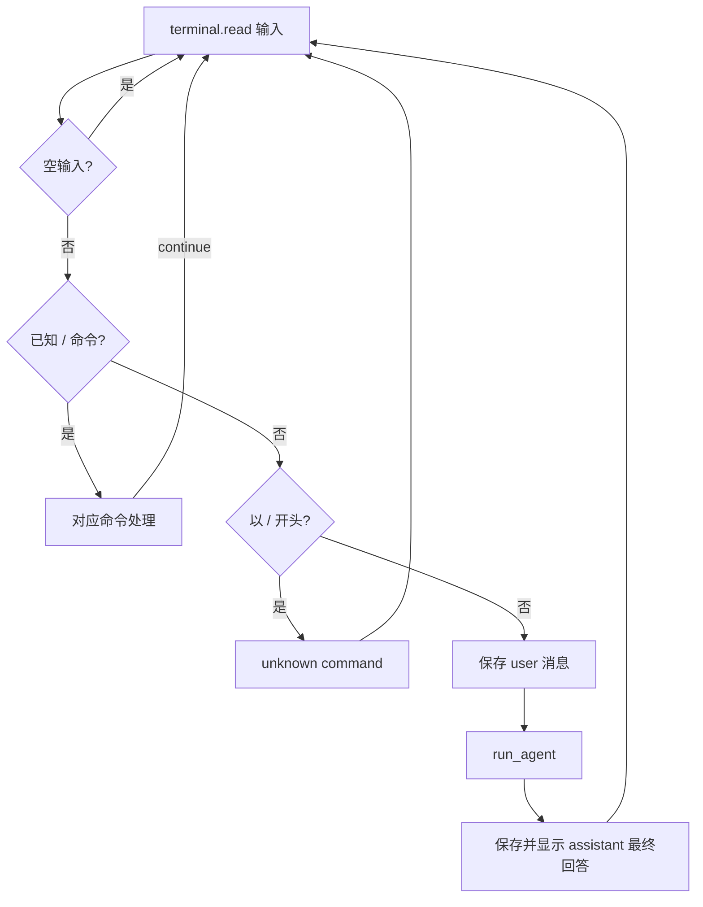
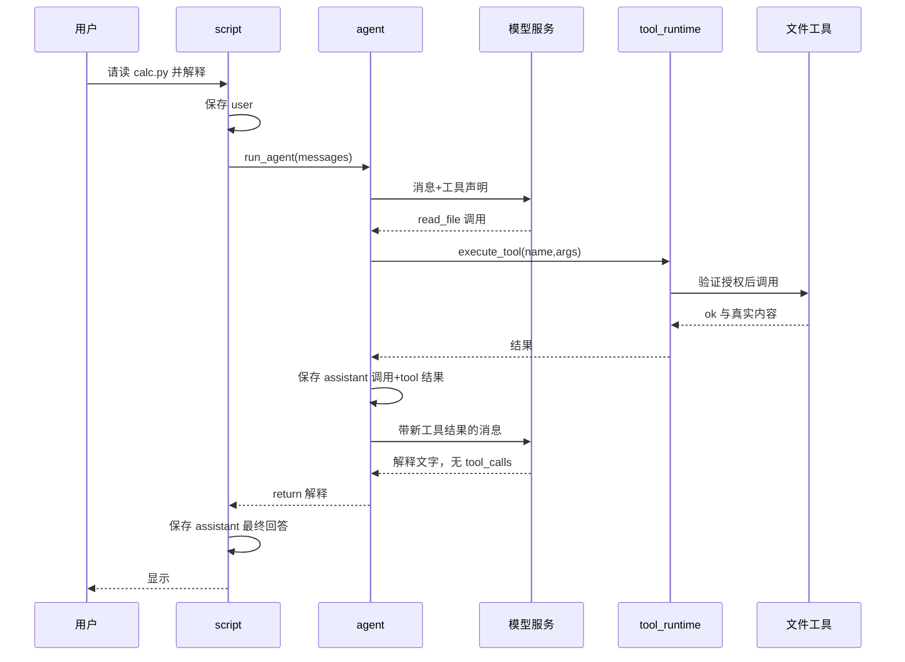

# 02：从启动到一次任务完成

配合 [cli.py](../../cli.py)、[script.py](../../script.py)、[agent.py](../../agent.py)、[model_client.py](../../model_client.py) 阅读。

## 1. 启动器为什么不是一行 `python script.py`

`ai-cli` 是 Bash 文件：`readlink -f "$0"` 找启动器真实位置，哪怕从符号链接启动；`dirname` 找安装目录；`exec` 用指定 Python 替换当前 shell 进程；`"$@"` 保留用户传入的每一个参数。它保证从外部项目启动时仍使用助手自己的环境。

`cli.build_parser()` 创建 argparse 解析器；`parse_args` 解析 `-C`、`--model`、`--provider` 等。解析发生在导入 `script.main` 前，所以 `--help` 可以打印帮助并结束，不去连接模型或启动 MCP。

`cli.main()` 修改配置字典，然后调用 `script.main`。命令参数覆盖的是本次进程的配置，不是自动改写 `config.py`。`--api-key-env` 保存环境变量名称，实际密钥在模型请求时从环境读取。

## 2. 启动函数逐步翻译

| 步骤 | 代码 | 为什么先做这件事 |
| --- | --- | --- |
| 绑定项目 | `script.main` → `with use_workspace(workspace)` | 后面的历史、文件、规则都要使用正确项目 |
| 退出清理保障 | `try ... finally: close_tasks()` | 中断/异常后也终止本次进程任务 |
| 清空旧 Skill 状态 | `clear_skills()` | 新 CLI 不继承旧内存状态 |
| 创建会话管理器 | `SessionManager()` | 保存默认路径并跟踪当前会话 |
| 可选切会话 | `switch(initial_session)` | 启动即加载用户指定的历史 |
| 创建输入对象 | `TerminalInput(plain=plain)` | 判断 TTY 或普通输入 |
| 加载项目规则 | `load_project_instructions()` | 之后构造请求时使用根 AGENTS |
| 进入资源范围 | `with terminal.confirmations(), MCPManager()` | 设置确认界面并持有服务连接 |
| MCP 自动加载 | `load_configured()` | 启动时向注册表提供外部工具 |
| 恢复消息 | `load_history()` 或切会话返回消息 | 启动记忆来自真实 JSONL |
| 开始交互 | `while True` → `terminal.read(...)` | 一次一次处理用户输入 |

这里确实存在 `messages = load_history()`，在函数定义之后、交互循环之前。它位于 `_main` 内部，不再是你最早版本的全局变量。

## 3. 命令和自然语言在入口分流



很多独立 `if` 依靠 `continue` 防止继续下落。`/read` 读完后必须 continue，否则可能再触发未知命令，或被当成模型任务。这与你早期遇到的“读出来了又显示 unknown command”是同一类控制流问题。

`command, separator, argument = user_text.partition(' ')` 提取命令名称与剩余文字；涉及文件路径的命令再使用 `parse_path_arguments` 处理引号。`/read` 只是展示给人，不自动把内容加入聊天；`/attach` 才保存成用户消息并参与后续模型上下文。

## 4. 最核心的数据结构：消息字典

| 字段 | 用途 |
| --- | --- |
| `role` | user / assistant / tool；请求还可能构造 system |
| `content` | 文字内容；工具结果也序列化为字符串 |
| `tool_calls` | assistant 提出的工具调用列表 |
| `function.name` | 对注册表的工具名称 |
| `function.arguments` | 内部使用字典参数 |
| `id` / `tool_call_id` | 兼容 API 配对调用与结果 |
| `tool_name` | 本项目保存工具结果对应的名称 |

例如模型提出读取：

```json
{"role":"assistant","content":"","tool_calls":[
  {"function":{"name":"read_file","arguments":{"path":"calc.py"}}}
]}
```

执行结果存为：

```json
{"role":"tool","tool_name":"read_file",
 "content":"{\"ok\": true, \"content\": \"def add(a,b): ...\"}"}
```

这里 content 是一段 JSON 字符串：外层是聊天协议，内层才是工具结果字典。分析它需要 `json.loads(message['content'])`，然后再读 `result['ok']`。`messages` 是这种字典构成的列表，不是文件对象，也不是模型内部记忆。

## 5. `run_agent` 怎样让模型连续工作

`run_agent(messages, output)` 先从后往前找最近用户任务，进入 `task_scope(task)`。该任务用于独立写入审查。然后 `_run_agent`：

1. 最多循环 `agent_config['max_rounds']` 次，当前为 8。
2. 调用 `request_message(messages)`，可启用流式 output 回调。
3. 检查返回字典、content、tool_calls 等结构。
4. 没有工具调用：返回文字，主循环负责保存最终回答。
5. 有工具调用：先验证整批最基本结构，然后按列表顺序执行。
6. 每个工具结果转成 role=tool 消息，与 assistant 的调用消息一起保存。
7. 将这一批消息加入内存列表，进入下一轮请求。



“Agent” 在本项目主要就是这段有状态循环，不是一个额外神秘模型。模型负责选择下一步，程序负责执行与保存。

## 6. 代理函数里几个关键变量

| 变量 | 为什么存在 |
| --- | --- |
| `tool_count` | 累计本次任务的调用次数，最多 12，跨轮计数 |
| `round_number` | 当前模型轮次；并非用户会话轮次 |
| `assistant_message` | 本轮模型完整响应 |
| `round_messages` | 一批调用与对应结果，准备一起保存 |
| `budget_exhausted` | 某工具超过预算，批次结束后停止代理 |
| `cancelled` | 当前工具取消后不执行同批后续工具 |
| `function` | 当前调用的 name/arguments 子字典 |
| `result` | 执行器返回的真结果或明确未执行原因 |

若一批有三个工具，第二个被取消，第三个不会执行，但仍记录“任务已取消，工具未执行”。超过预算也会补结果，避免历史里出现有调用却无结果的坏链。整批结果先序列化再追加，可避免 Python 序列化失败写半条记录，但**不等于数据库事务或任意断电原子性**。

整批“先验证”仅检查调用结构；具体 schema、权限和目标是否有效仍由每次 runtime 调用验证。工具按顺序执行，主代理这里没有并行调度。

## 7. HTTP 请求如何形成

`model_client.request_message` 是模型访问的统一接口。

| 阶段 | 行为 |
| --- | --- |
| 参数检查 | timeout 合法，响应大小上限为正整数 |
| 工具声明 | `get_tool_definitions()` 动态读取当前注册表 |
| 自动摘要 | 正常带工具上下文请求才 `maybe_compact` |
| 构造上下文 | `prepare_context` 注入规则，选择完整历史轮次 |
| 请求字典 | model/messages/stream/tools |
| 协议分流 | ollama→`/api/chat`；openai→`/v1/chat/completions` |
| 编码 | `json.dumps(...).encode('utf-8')` |
| 发送 | urllib Request，POST、Content-Type JSON |
| 接收 | 非流式整段 JSON，流式交给对应收集器 |
| 校验与返回 | `validate_message`；返回统一 assistant 字典 |

项目没有使用 OpenAI SDK；“openai provider”是代码选择兼容 Chat Completions 格式，并不保证兼容所有供应商的所有扩展字段。HTTP 密钥来自环境，不写进会话；携带密钥的请求拒绝重定向，防止被转发到其他地址。

## 8. Ollama 与兼容 API 为什么需要适配

| 项目 | Ollama | 兼容 Chat Completions |
| --- | --- | --- |
| 流式封装 | 一行一个 JSON，NDJSON | `data:` 事件，空行分隔，SSE |
| 完成标记 | `done: true` | finish_reason + `[DONE]` |
| 工具参数 | 内部字典形式 | API 常用 JSON 字符串 |
| 工具结果配对 | 项目保存 tool_name | 要求 tool_call_id |
| 非流式消息 | `message` | `choices[0].message` |

`wire_messages` 将字典参数 dumps 成字符串，生成/保留 ID，并配对结果。`normalize` 将 API 返回的字符串参数 loads 回字典，检查重复 ID。`collect_sse` 按 index 缓存工具调用片段，把 name 与 arguments 逐段拼好，到完成标记才 normalize。

Ollama `collect_stream` 累加 content/thinking 与工具调用；每个块都检查结构和 done 类型。不完整流会报错，未完成工具请求不会交给 agent 执行。**文字可以先显示；工具必须等待完整响应才执行。** 这是流式实现最需要讲清的一点。

## 9. 流式显示为何没有打印两次

`ConsoleOutput.begin` 清空本轮 content/started；`write` 第一次输出前缀，以 `flush=True` 立即显示片段；`end` 换行。主循环调用 `final(reply)`，若该文字已完整显示且相同，不再重复打印。

工具循环每次请求都 begin，避免上一轮工具说明被误当最终回答。模型客户端只保留 `request_message` 这一请求接口；主流程由 `run_agent` 组织工具循环，不再有旧的 `generate_reply` 兼容接口。

## 10. 出错时消息在哪里

用户消息在请求前已保存；网络失败通常没有新的 assistant 最终回复。完整工具批次在每轮后保存，即使下一轮请求失败，也保留已执行的工具证据。取消/超时不撤销先前文件修改。

`script.py` 分别处理模型格式错误、HTTP 状态、连接错误、超时，再 continue 等下一次输入。“timeout 5/5”目前是固定错误文字，**不是实现了五次重试**。面试不要把这个梗当成重试机制。

## 11. 对着代码做三次口头跟踪

- 输入 `/history`：经过哪些函数？为什么没有调用模型？
- 输入“读取 a.py”：至少两次模型请求为什么可能出现？
- 一个响应提出两个工具：谁决定第二个能否执行？结果怎样与调用匹配？

能不看提示回答这些问题，才算懂了这一章。
