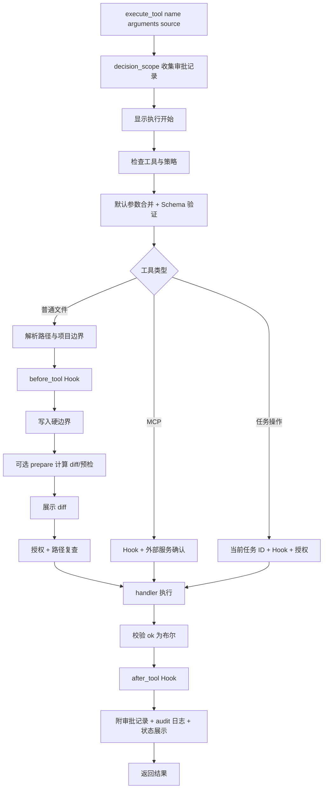

# 03：工具是怎样被登记、审查和执行的

配合 [tool_registry.py](../../tool_registry.py)、[tool_runtime.py](../../tool_runtime.py)、[permissions.py](../../permissions.py)、[approval.py](../../approval.py) 阅读。

## 1. 三份东西不能混为一谈

| 名称 | 内容 | 谁使用 |
| --- | --- | --- |
| 工具声明 | 名称、说明、JSON Schema | 发给模型，告诉它可提出什么调用 |
| 工具调用 | 模型给的 name 与 arguments | 执行器收到的待验证请求 |
| 工具实现 | Python handler 函数 | 客户端获准后实际调用 |

模型只看到声明，不获得函数对象或 OS 权限。`TOOL_REGISTRY` 包含声明和实现绑定；`get_tool_definitions` 只提取可发送的部分，`deepcopy` 避免调用方修改注册表内 schema。

## 2. 注册表中的一项

```python
'read_file': tool_spec(
    '读取项目内的 UTF-8 文本文件，返回内容或错误。',
    'read',
    {'path': string_parameter('文件路径', 1)},
    ['path'],
    read_file
)
```

`tool_spec` 生成字典；`string_parameter` 生成一个字段的 schema。最后参数是函数引用，不是 `read_file(...)` 的结果。

| 注册项字段 | 意义 |
| --- | --- |
| `description` | 帮模型选择工具的说明 |
| `operation` | read/write/execute，权限策略按此分类 |
| `parameters` | object schema，properties/required/additionalProperties |
| `defaults` | 如 search_project 的 path='.'、glob='*' |
| `handler` | 获准后调用的 Python 函数 |
| `prepare` | 可选准备函数：计算 diff、校验沙箱等 |
| `details` | 显示或授权用说明 |
| `kind` | task 或 mcp 等特殊路径；普通文件工具通常无此键 |

`additionalProperties=False` 的工具不接受多余参数。MCP schema 来自服务，规则不同但仍经过 JSON Schema 验证。

## 3. 统一执行入口的完整顺序



任一步失败都返回明确 `{'ok':False,'error':...}`。外层继续规范结果、记录并显示，不能由模型自己绕过某层。

`source` 由可信 Python 调用者传：主代理默认 model，手工命令使用 user。它不是模型 arguments 的一个可调字段。两种来源当前读操作均不确认，写/执行均有审批策略；user 不等于“自动允许所有动作”。

## 4. 为什么有 `prepared`

编辑需要先读取旧内容、编码新内容并生成 diff，然后才审批。若直接先写再问，就没有可审查的未来动作。

| 变量 | 保存什么 | 谁传给谁 |
| --- | --- | --- |
| `original_path` | 用户/模型原始路径字符串 | 准备阶段用于检查符号链接层级 |
| `normalized['path']` | 解析后的真实绝对路径 | 统一边界检查 |
| `prepared` | 路径、字节快照、diff、沙箱参数等 | prepare → 审批 → handler |
| `authorized` | 本次授权与复查结果 | permissions → runtime |

有 prepare 时调用 `handler(prepared)`；没有时调用 `handler(**normalized)`。不是每个工具都同一个函数签名，注册项告诉执行器怎样调用。

## 5. 路径边界与权限是两层

`resolve_project_path`：检查非空/NUL → 相对路径接 PROJECT_ROOT → resolve 真目标 → 是否在项目下 → 是否包含 blocked_names。它回答“这个目标能访问吗”。

`check_tool_policy`：查询 `permission_config['confirmation'][source][operation]`。缺配置、未知来源或非布尔配置拒绝。它回答“这种动作是否需要确认”。

`authorize_tool`：边界检查、审批、再次解析比较，回答“这次操作获准了吗”。底层 handler 还会复查关键条件。

| 请求 | 结果原因 |
| --- | --- |
| `../outside.py` | 真目标在项目外，拒绝 |
| `.ai-cli/history.jsonl` | 私有状态被屏蔽，拒绝 |
| 项目内 symlink 指向私有目录 | 检查真实目标，拒绝 |
| 普通 a.py 读取 | 边界合法，默认无需确认 |
| 创建已存在文件 | 新建工具拒绝覆盖，与是否批准无关 |
| 写助手自身 .py | write_boundary 硬拒绝，自动模型不能批准 |

拒绝名单是明确名称列表，不是通用的“检测所有秘密”引擎。不能声称它能自动识别任意文件中的密钥。

## 6. 自动审批怎样实现

`approval.task_scope` 保存最近用户任务；`decision_scope` 收集本次操作的规则/模型/人工决策。它们都用 ContextVar 与 with/yield/finally 保证范围退出恢复。

| 动作 | auto 模式决策 |
| --- | --- |
| 普通读取 | 按配置免确认，但路径限制仍在 |
| 准备成功的 run_tests/start_pty | 规则允许，只读禁网沙箱 |
| spawn_agent | 启动独立开发 worker；worker 的文件与任务操作仍经过统一 Runtime 和对应策略 |
| owned PTY input / task_cancel | 对当前进程任务按规则允许 |
| 小规模普通 edit_file/create_file | 独立模型上下文审查 diff |
| 控制文件、未知类型、大 diff、无任务 | ask，转人工 |
| MCP 服务与工具 | 外部人工确认，未走普通文件自动审查 |

独立 reviewer 使用同一模型访问函数，但 `use_tools=False, include_context=False`，不传父聊天、AGENTS、Skills 或 API 密钥。输入只含 task/tool/target/diff；系统提示要求 JSON 恰好有 decision/reason。不是额外拥有执行权限的代理。

`allow + task_aligned` 才自动允许；deny 拒绝；ask/服务失败/坏 JSON/工具调用等都转人工。SHA256 request_hash 用于审计请求一致性，不是“证明模型安全”的签名。

子代理通过统一执行器调用 `edit_file` / `create_file` 时，auto 模式复用独立 `review_write` 审查。manual 模式把请求写入 `TaskApprovalStore.pending`；任务卡或 CLI `/approve_task`、`/reject_task` 解决请求后，worker 只消费一次审批结果，再继续执行。这条流程由 Runtime 与 TaskApprovalStore 完成，不加载 LangGraph。等待审批时不持有工作区写锁。

`harness/infrastructure/workspace_locks.py` 将锁文件放在规范化工作区的 `.ai-cli/locks/write.lock`。Runtime 仅在写入已经获批、进入最终文件提交阶段时持锁；准备和审批期间不持锁。这把并发互斥限制在真正发布文件的窗口，不把审批等待误说成锁保护区。

同一个模型的独立 reviewer 上下文也不保证完全抵抗注入，因此硬边界必须在代码中。

## 7. 文件读取与搜索分别怎么做

`file_tools.read_file` 二进制读取最多 1 MiB+1，用多出的字节检测超限，然后 UTF-8 解码。目录/不存在/权限/编码分别返回错误。`search_file` 复用读内容，`splitlines` 后逐行进行 `keyword in line` 字面匹配；结果是 matches 列表中的字典。

`result['matches'][0]['line_number']`：先取结果字典里的列表，再取第一个字典，再取行号。若没有匹配，列表为空，直接 `[0]` 会 IndexError；应检查或用 for 遍历。

`project_search.search_project` 递归 os.walk；修改 `directories[:]` 来阻止进入被跳过目录；跳过链接、二进制/NUL、非 UTF-8、大文件。它用 glob 过滤文件名/路径，用 find 找关键词，以有限片段返回。数量、时间、读取字节、结果字符限制触发后返回 `ok=True,truncated=True`，表示成功得到部分结果，不表示完整搜遍。

文件名模糊查找在 `file_catalog`，正文查找在 `project_search`，不是同一功能。也没有调用 `rg` 作为产品搜索工具。

## 8. 修改已有文件的两阶段过程

`patches.prepare_edit` 返回：original_bytes/new_bytes/path/changed/diff。

`build_diff` 用 `difflib.unified_diff` 比较旧/新逐行字符串，并显式展示末行无换行的情况。模型提交的是**完整新文件内容**；这里没有解析模型给的 patch 文本，也没有实现通用 apply_patch 协议。

`apply_prepared_edit`：

1. 内容没变化则成功返回 changed=False。
2. 重查真实路径，确认当前字节等于审查的 original_bytes。
3. 在目标父目录建临时文件；写入、flush、fsync。
4. chmod 保留原权限模式。
5. 再检查路径与原字节。
6. `os.replace(temporary, target)` 原子发布。
7. finally 清理未发布临时文件。

为何同一目录？有助于同一文件系统原子替换。flush 将 Python 缓冲交给 OS，fsync 请求同步文件数据。原子替换意味着观察者一般看到旧文件或新文件，而非写到一半；它不是全项目事务。Runtime 的工作区写锁只覆盖最终提交，不覆盖前面的准备和审批。

## 9. 新建文件为什么不用 replace

`new_files.check_new_target` 拒绝已存在目标以及原路径各层符号链接。`prepare_create_file` 限 UTF-8、NUL、1 MiB，再生成从空文件到新内容的 diff。

应用阶段写好临时文件后 `os.link(temporary,target)`。目标已存在时 link 失败，不会像 replace 覆盖。这在并发创建同名文件时尤其重要。成功后删临时名字，目标仍指向完整内容。`skill_files` 对固定 `skills/<name>/SKILL.md` 使用同样的独占发布思想。

## 10. 日志、显示与返回值

| 通道 | 记录什么 | 用途 |
| --- | --- | --- |
| 终端状态 | 工具名、目标摘要、成功/错误、diff | 用户观察 |
| `tool_events.jsonl` | 时间、tool、ok、error、审批、取消、Hook warning | 审计摘要 |
| 聊天 JSONL | assistant 调用和 tool 的完整结果字符串 | 恢复上下文与模型验收 |

audit 不记录完整源码和完整 diff，但聊天工具结果可能含文件内容。私有目录与上传排除很重要。日志写失败打印警告，不能据此声称事件持久化成功。

`safe_text` 转义终端控制字符用于工具显示，不改变实际工具结果，也不解决语义 prompt injection。部分旧 `/read` 直接 print 路径仍是原实现，不能夸成所有显示入口都已统一。

## 11. 新增工具应如何走

写 handler（实际能力）→ 如有准备/副作用写 prepare → 注册 schema、operation、handler → 通过 execute_tool 验证 → 用测试检查拒绝和正确执行。不要在 script 写一份旁路实现，或仅在给模型的列表加名字却没有 handler。

查函数全貌时看本套教程的逐文件导读，它列出每个 helper 的真实签名和 return 分支。
