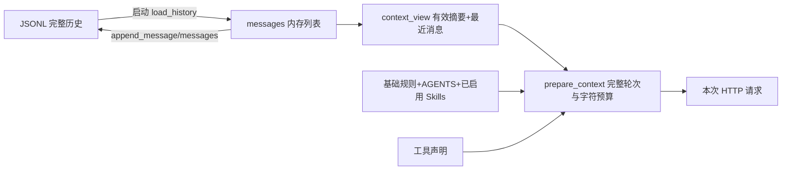

# 04：历史、会话、规则和压缩究竟存在什么地方

配合 [history.py](../../history.py)、[sessions.py](../../sessions.py)、[context_window.py](../../context_window.py)、[compaction.py](../../compaction.py) 阅读。

## 1. “模型有记忆”的实际意思

模型请求本身不自动读取硬盘。每次请求，CLI 从 messages 选择历史放进 HTTP 请求，模型才能依据它回答。重启后先从 JSONL 恢复 messages。服务端模型权重没有因这次聊天改变，也没有训练模型。



## 2. 四种状态的区别

| 状态 | 所在位置 | 重启是否保留 |
| --- | --- | --- |
| 原始聊天与工具证据 | JSONL 文件 | 是 |
| 当前消息列表 | `_main` 的 messages | 重新从文件恢复 |
| 当前模型/流式/审批配置 | config 字典 | 本次修改通常不自动保存，下次按文件/参数 |
| 已启用 Skill 集合 | active_skills 与会话快照 | 本进程切会话恢复；重启需重新启用 |
| MCP 连接 | MCPManager.services | 整个 CLI 共享，重启重新加载 |
| PTY/子代理任务 | 本地模式下的 `harness.tasks.processes.JOBS` | 仅当前任务服务进程，退出清理；Runtime 也可把任务操作转发到 `TASK_BACKEND` |
| 摘要检查点 | 原会话 JSONL | 是，校验有效后恢复 |

## 3. `history.py` 每个函数在做什么

| 函数 | 实现步骤 | 返回 |
| --- | --- | --- |
| `append_messages` | 先把整批消息序列化成每行 JSON；创建父目录；a 模式追加 | 无显式 return→None |
| `append_message` | 包成单元素列表，复用 append_messages | None |
| `load_history` | 逐行读，跳空行/坏 JSON/坏基本字段；合法记录加入列表 | messages 列表 |
| `clear_history` | w 模式打开后不写内容，清空文件 | None |

JSON 是一个数据格式，JSONL 是“一行一个 JSON”的约定。append 不能把多个 JSON 直接连在一行；必须 `+ '\n'`。`ensure_ascii=False` 让中文直接保存。load 的基本检查不等于完整校验工具链，链完整性由上下文处理负责。

文件不存在得到空列表；权限或整个文件编码错误并没有全部被 load_history 捕获，需要上层或启动错误处理。不要把“坏行可跳过”理解为“任何历史损坏都自动修复”。

## 4. 会话管理器为何改变全局 HISTORY_PATH

所有保存函数都读取 `history.HISTORY_PATH`。`SessionManager.switch` 成功后将它改为目标会话文件，下一次保存自动进入该文件。

切换顺序是：检查名称与路径 → 读取目标 → 必要时独占创建文件 → 保存旧 Skill 状态 → 恢复新 Skill 状态 → 提交 HISTORY_PATH 与 current_name。先读成功再改当前状态，避免加载失败后把新消息写错会话。

会话名限 1–64 个字母/数字/_/-；禁止 rename 保留字；拒绝会话目录或文件是符号链接。`default` 对应默认历史，其他名称对应 sessions/name.jsonl。

`rename` 用硬链接独占建立新名字，再删旧名字，避免普通 rename 可能覆盖另一份同名会话；删旧失败会撤销新链接。`export` 将当前 messages 写成易读 JSON，普通会话 export.json；它不等于第一次保存，聊天本来就已经自动追加。clear 要同时清磁盘与内存，否则下次请求仍带旧记忆。

## 5. 一轮对话不等于一条消息

```text
user: 修复 calc.py
assistant: 调用 read_file
 tool: 读取结果
assistant: 调用 edit_file 和 run_tests
 tool: 修改结果
 tool: 测试结果
assistant: 最终说明
```

这整个块是一轮用户任务。`split_turns` 见到 user 开始新块；`valid_turn` 用 pending 队列记录 assistant 提出的工具名，随后 tool 必须按顺序消耗。未对应 user 的开头残留不发送，坏旧轮次可跳过，坏最新轮次直接停止请求。

为何不能只保留最后 N 条消息？如果从一条 tool 结果开始，模型看到“执行成功”，却不知道对应哪个调用；兼容 API 也可能直接拒绝这样的消息链。保留完整用户轮次是本项目的基础规则。

## 6. `prepare_context` 怎么选择历史

1. 验证 max_request_chars 与 max_history_turns 为正整数。
2. `context_view` 拿到有效摘要和未被摘要覆盖的消息。
3. 构造基础规则、AGENTS、Skills；摘要以 assistant 数据消息加入。
4. 保留请求开头已有 system 消息，用于某些独立请求。
5. 把用户历史拆成完整轮次。
6. 系统规则+工具声明自身超预算则报错。
7. 从最新轮次向前选择，候选整体请求超预算则停止；最新单轮超预算直接报错。
8. 返回真实发送 messages、字符数、保留轮次、被省略消息数等。

`request_size` 计算序列化 JSON 长度。兼容 API 要先 wire_messages，计入参数字符串转义。这里不是 tokenizer，也不是账单 token；最大字符预算不能严格保证某模型上下文窗一定够用。

`omitted_messages` 表示本次 HTTP 没发，不表示磁盘被删除。`/context` 调 prepare_context 做预览；真正正常请求时 model_client 才可触发自动压缩。

## 7. 裁剪与压缩有什么区别

| 操作 | 怎样处理旧历史 | 请求中的效果 | 磁盘 |
| --- | --- | --- | --- |
| 裁剪 | 本次不发送旧完整轮次 | 最新轮次保留，无旧细节 | 原记录不变 |
| 摘要压缩 | 模型归纳旧记录，生成 checkpoint | 摘要+最近完整轮次 | 追加 checkpoint，原记录不删 |
| `/clear` | 清空当前历史 | 后续无聊天记忆，规则仍在 | 文件清空 |

压缩不是 zip，不可精确还原细节；通过保留原 JSONL 可事后查证。摘要不能从 assistant 数据升级为权限规则。

## 8. 检查点结构

```json
{"role":"assistant","content":"用户目标、文件与测试摘要...",
 "context_checkpoint":{"version":1,"covered_messages":14,
 "prefix_hash":"原消息前缀 SHA256","excerpted_records":0}}
```

| 字段 | 用途 |
| --- | --- |
| version | 当前检查点协议版本 |
| covered_messages | 原始 messages 前多少条被概括 |
| prefix_hash | 验证摘要仍对应那段原历史 |
| excerpted_records | 摘要输入中被截成片段的记录数 |

`context_view` 遍历所有 checkpoint，检查类型、位置、摘要长度与 hash，选择覆盖最多的有效摘要；后面的 checkpoint 不再当普通聊天发送。hash 保证前缀一致性，**不验证摘要内容真实或毫无遗漏**。

## 9. 手动压缩怎样完成

`plan_compaction` 留最近两轮，必要时降至一轮，始终保留最新完整工具链。算出 old/tail/covered/previous_summary/prefix_hash。

`compact_messages` 验证磁盘历史和内存一致；保存当前 digest；`_summarize` 对旧记录有限分批，每条超过 4000 字符截片段，单次最多 6 批；把上一批摘要与下一批记录逐步合并。摘要模型无工具、无项目上下文，每次最多 4000 字符。

得到摘要后检查摘要+tail仍可放入预算，再确认内存和磁盘没在生成期间变化，最后追加检查点并加入内存。失败时返回错误而不替换原历史。摘要越长/记录越多越慢，所以有输入和批次数上限。

## 10. 自动压缩怎样触发与防止死循环

正常工具请求前调用 `maybe_compact`。当前请求达到字符预算 80% 或用户轮次数超过限制，才尝试计划。最近轮次本身超限、没有旧轮次、记录不一致等则不摘要，仍由 prepare_context 决定能否请求。

摘要内部 `request_message(..., use_tools=False, include_context=False)` 不再触发 auto_compact，否则会递归调用自己。失败缓存 FAILURES 按 HISTORY_PATH+旧前缀 hash 记忆同一失败，不在每个工具轮次重复摘要失败；最多保存 32 项。

`/compact` 手动；`/compact status` 看状态；`/compact auto on/off` 改本次配置。子代理与独立审查也不自动压缩父会话。

## 11. 你应能解释的场景

- 重启 CLI 还能记住文件名：JSONL→messages→HTTP，而非模型永久记忆。
- history很长，但 `/context` 省略很多：磁盘完整与请求有限是两件事。
- AGENTS 改了但本进程仍旧规则：启动加载状态，需重启。
- 摘要前缀被改过：hash 不匹配，该摘要不再有效。
- 一条巨大文件工具结果超预算：压缩旧轮次不能解决最新一轮太大的问题，应缩小输入/结果。
