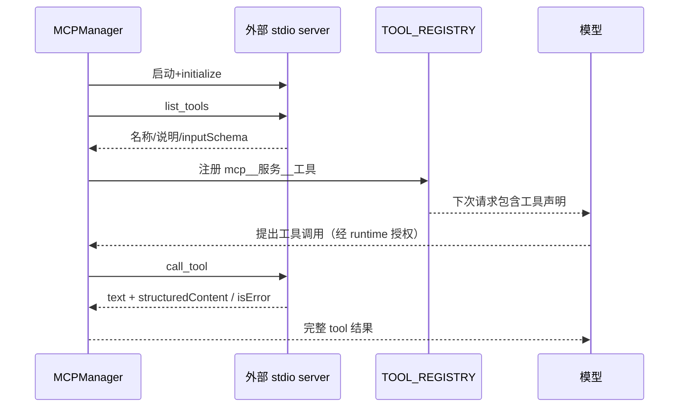

# 05：MCP、AGENTS、Skills、Hooks 与浏览器

## 1. 它们不是五种相同的 prompt

| 机制 | 本项目中的作用 | 执行什么 | 接入位置 |
| --- | --- | --- | --- |
| AGENTS.md | 项目长期开发规则 | 不自动执行文件命令 | project_instructions → 请求 system |
| Skill | 手动启用的可复用任务流程 | 不自动执行 Markdown | skills → 请求 system |
| Hook | 可信客户端事件回调 | 真正运行 Python 函数 | runtime 前后 |
| MCP | 外部工具协议 | 启动服务，协议调用服务工具 | manager/client/tools → registry/runtime |
| 浏览器 | 一种实际外部工具能力 | Playwright 操作 Chromium | browser MCP server |

前三者的“规范任务”与 MCP 的“执行能力”不同。规则文字可以指导模型提出动作，只有工具调用经执行器获准后才发生。

## 2. MCP 用一句实际例子理解

你写的主 CLI 不需要知道 add 如何计算，只要启动一个服务，通过 MCP 问“有哪些工具”，得到 add 的参数 schema，再发“请调用 add，a=19，b=23”，拿回真实结果。浏览器也复用这个协议；主 agent 不直接 import Playwright。

模型读到 MCP 工具是因为客户端把声明加入请求，不是模型直接扫描 MCP 配置文件。当前启动自动加载配置服务，不需每个对话再 `/mcp tools`；连接为 CLI 进程共享。首次服务启动和各次工具操作仍走授权。

## 3. 三个 MCP 模块分别负责什么

| 文件 | 函数/类 | 细节 |
| --- | --- | --- |
| mcp_client | prepare_server_connection | 可信配置名称→绝对解释器、固定 args/cwd、有限环境和超时 |
| mcp_client | collect_tools | 分页发现，拒绝循环 cursor，最多 200 工具 |
| mcp_client | call_session_tool | 调用前重查声明，调用服务，限制结果格式和 16000 字符 |
| mcp_client | execute_prepared_mcp_tool | runtime handler 转发给 manager |
| mcp_tools | check_schema | object schema，仅允许本地 `#/` 引用，拒绝网络/文件引用 |
| mcp_tools | register_server_tools | 整批检查后更新注册项，避免半批登记 |
| mcp_tools | unregister_server_tools | 断开连接时移除该服务的动态工具 |
| mcp_manager | MCPManager | 常驻连接、同步异步桥、刷新、关闭与取消 |

注册名 `mcp__browser__click` 由服务名 browser 和远端工具名 click 拼出，名称限格式及长度，避免不同服务工具冲突。注册 handler 使用 partial 绑定连接与 schema。

## 4. stdio、portal、queue、future 怎么组合

stdio 不是网络端口：子进程 stdout/stdin 承载协议，日志应写 stderr。`stdio_client` 负责启动服务及读写流，`ClientSession` 管握手和协议。

主 CLI 是同步的。`MCPManager.__enter__` 创建 anyio blocking portal，后台线程运行事件循环。`connect` 通过 `portal.start_task(_serve,...)` 启动连接拥有者；started 信号返回已握手句柄，而不是“进程一创建就当连接成功”。

拥有者 `_serve_connected` 在同一个异步任务里进入和退出 SDK async context。它持有 session，循环等 Queue 请求：refresh、call、close。同步 `request` 用 portal.call 把请求放入 queue，Future 收结果；同时等待拥有者 future，避免服务死了还无限等响应。

| 变量 | 含义 |
| --- | --- |
| services | 服务名→连接句柄 |
| queue | 排队的协议操作，当前实现串行处理 |
| response | 本次操作的 asyncio Future |
| future | 连接拥有者任务的生命周期结果 |
| closed | finally 中设置的 Event，表示清理已走完 |
| connection | 固定解释器/args/cwd/timeout 与 manager 路由 |

通信异常会标 disconnected，注销工具；工具自身 `isError` 通常只是本次失败，不应误断整服务。Ctrl+C abort 取消拥有者任务，等待清理，不排队等待普通 close；`/mcp refresh` 可重连。正常退出 __exit__ 逐个 disconnect。

## 5. 为什么 MCP 不统一套本地路径检查

外部工具可能收 url、数据库查询或自己的文件路径，它的参数不是本项目文件工具路径。把外部路径 resolve 成 PROJECT_ROOT 会制造错误的隔离假象。

MCP 共用 schema、Hook、审批、日志，但采用 external execute 策略，服务以当前用户权限运行，**未统一放进 bubblewrap**。服务能力和安全依赖可信配置及实现，当前只支持文本和结构化 JSON，不支持完整 MCP resources/prompts 等。

## 6. AGENTS 的实现比“加一句 prompt”多在哪里

`load_project_instructions` 每次先清旧状态，解析根 `AGENTS.md`，二进制读取 64 KiB+1，UTF-8 BOM 解码，区分 loaded/empty/missing/error。这样读取失败不会悄悄使用旧规则。

`build_model_messages` 新建系统消息列表：基础执行规则→项目 AGENTS→已启用 Skills→传入聊天。不把 system 规则写入历史，否则反复请求会不断复制。`instruction_state` 是启动快照；根之外的 AGENTS 不递归查找。

规则不能改变权限限制。一个 AGENTS 写“允许读 /etc/shadow”仍被 resolve_project_path 拒绝；prompt 与 OS/程序权限是两个层次。

## 7. Skills 的实现

`check_skill_path` 限名称与固定目录；`list_skills` 找 `skills/<name>/SKILL.md`；`activate_skill` 读 32 KiB 内文字、非空、最多 3 个、合计 64 KiB；active_skills[name]=content。`get_skill_messages` 转 system 指导消息；clear_skills 清内存。

它不是动态 import Python，也不会把 Markdown 里的 shell 命令自动运行。生成 Skill 时先检查目标不存在，构造独立无工具模型请求，验证正文/围栏/长度，然后执行 create_skill，展示 diff 和审批，独占创建文件。**生成、保存、启用是三件事**，生成成功不自动启用。

## 8. Hook 的每一层

`hooks_config` 包含 before_tool/after_tool 名称列表和 denied_tools。`HOOK_HANDLERS` 是可信函数白名单映射，模型不能给一个任意模块名让客户端执行。

`run_hooks(event,context)` 按名单顺序：查 handler→deepcopy(context)→调用→验证字典与布尔 ok。复制快照让回调不能通过改 arguments 字典偷偷改变实际动作。

before_tool 的拒绝或错误阻止执行；after_tool 失败写 `hook_warning`，保留真实工具结果。after 阶段是事件观察，不能声称“文件写成功后 Hook 失败，所以文件没写”。当前示例 deny_configured_tools 负责工具黑名单，report_write_result 打印写入结果；没有外部 shell Hooks。

## 9. 浏览器是这套机制的完整应用

browser_server 的七个函数都只是参数明确的 MCP 包装，invoke 调 controller 相应方法。lifespan async context 在服务正常关闭时 close 浏览器。Chromium 不是启动 CLI 时立即加载，而是第一次 open_page 才 `_start`。

| controller 方法 | 实际动作 | 关键语法/机制 |
| --- | --- | --- |
| validate_url | 只允许无嵌入凭据 HTTP(S)、长度与控制字符检查 | urlsplit、异常、any |
| _start | Playwright、Chromium、临时 context、单 page | async/await、异常清理 |
| _route | 子资源请求 URL 校验 | route.continue_/abort 回调 |
| open | goto，等 domcontentloaded，记录 HTTP 状态 | await、read 复用 |
| read | 固定内部 JS 取短正文与可见元素，刷新 ref | evaluate 固定脚本、字典构造、体积裁剪 |
| _locator | 验证最新编号，转内部 CSS locator | refs 映射，过期编号拒绝 |
| fill | 禁密码/文件、长度限制，填写后 read | await locator.fill |
| click | 点击，等待文档状态，再 read | 异步等待；实际异步页面仍可需 wait_text |
| wait_text | 等可见指定文字，最多 5 秒 | locator.first.wait_for |
| screenshot | 视口 PNG，私有目录、独占文件、数量体积限制 | bytes、Path、xb |
| close | 清 refs 与对象，再关闭 browser/Playwright | try/finally |

read 的固定 JS 扫描前 200 候选，最多 15 个可见交互元素，文本最多 2000 字符，再控制 JSON 体积。ref 来自随机前缀加编号，并写到 DOM 属性。每次 read/fill/click 等返回新 ref，旧编号不能复用。

临时 BrowserContext 不使用用户日常浏览器档案；关闭后 Cookie 清除。`accept_downloads=False`、取消 download、新窗口自动关闭；没有视觉模型、任意 JS、上传或密码输入接口。服务最多保存 32 张，单张不超过 4 MiB。

浏览器启用 Chromium 自身 sandbox，但它可以联网，也允许本地开发 URL。没有按站点网络白名单，不是项目测试隔离；固定内部 JS 不是说页面自身不执行网站 JavaScript。

## 10. 文件内容像错误文本，怎样判断

不要解析 content 的措辞来判断成功：`{'ok':True,'content':'permission denied'}` 表示真实读到了这些文字；`{'ok':False,'error':'permission denied'}` 才是执行失败。网页说“工具成功”也不能替代真实结果字段。

结构化协议解决状态歧义；提示词标记外部数据降低模型误解；schema/权限硬规则限制动作。三个手段作用不同，都不能单独保证零注入攻击。
