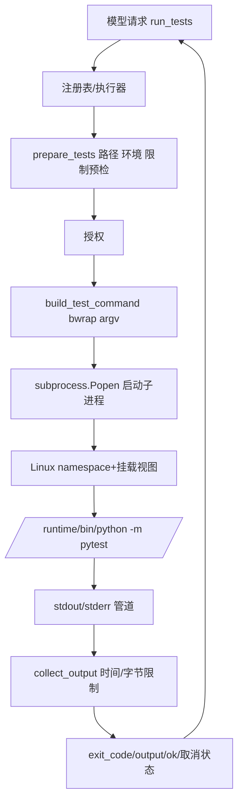
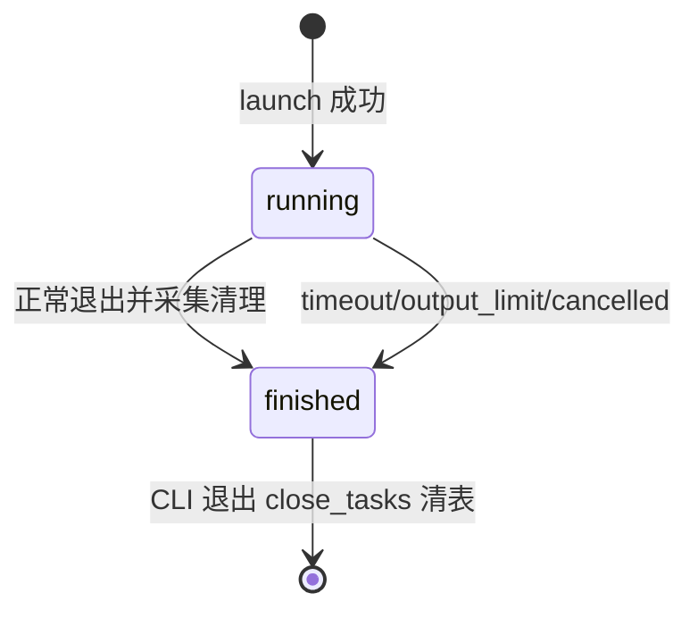
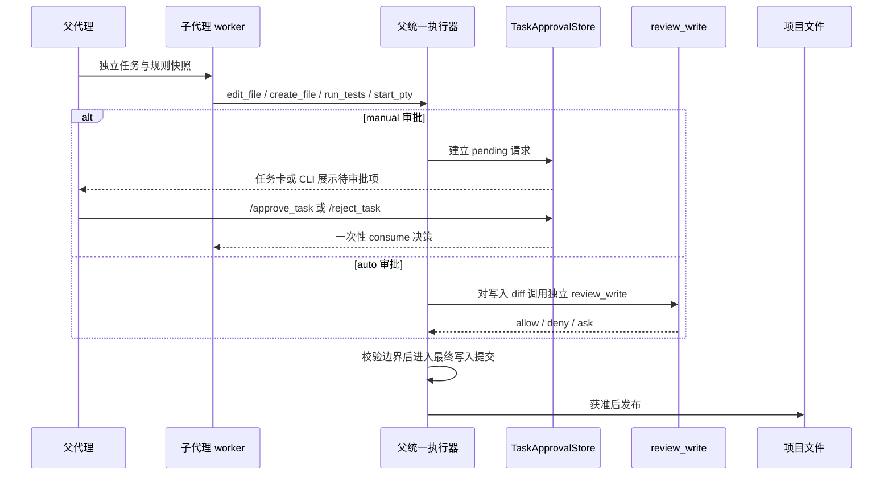

# 06：沙箱、PTY、后台任务与子代理

这一章是面试时最需要讲准确的部分。先读 [sandbox.py](../../sandbox.py)，再读 [任务 API](../../harness/tasks/runtime.py)、[进程驱动](../../harness/tasks/processes.py)、[任务审批存储](../../harness/tasks/approvals.py) 和 [工作区写锁](../../harness/infrastructure/workspace_locks.py)，最后读 [subagent_worker.py](../../subagent_worker.py) 与 [agent_proposals.py](../../agent_proposals.py)。

## 1. 沙箱不是 `try/except`

try/except 处理 Python 异常，不能阻止被测代码写文件或访问网络。这里用 Linux 系统程序 bubblewrap（bwrap）设置进程看到的文件系统与 namespace，然后在其中运行 pytest。

运行编程项目的任意测试也意味着执行项目代码；“只是跑测试”并不天然安全。隔离正是为它提供执行边界。

## 2. 三个基础概念：namespace、挂载、进程

| 概念 | 本项目含义 | 不是 |
| --- | --- | --- |
| namespace | 给进程一份相对独立的资源视图，例如网络、PID | 新建完整虚拟机 |
| 挂载/bind mount | 将宿主目录映射到沙箱路径，设置只读或临时替身 | 将所有内容复制到新目录 |
| 进程 | 操作系统调度的正在运行程序 | Python 普通函数或聊天窗口 |

例如宿主项目 `/home/me/demo` 映射为沙箱 `/workspace`；解释器目录映射为 `/runtime`。项目只读意味着沙箱进程在这份挂载视图中不能直接修改源码；父 CLI 在宿主使用文件工具仍可获准修改。两种执行发生在不同路径。

## 3. bwrap 参数逐项对照

| 参数组 | 实际作用 | 为什么需要 |
| --- | --- | --- |
| --unshare-user | 新用户 namespace | 配合 namespace 创建与权限隔离 |
| --unshare-pid | 新 PID namespace | 测试不共享正常宿主进程视图 |
| --unshare-net | 新网络 namespace | 不接入宿主网络；不提供外网连接 |
| --unshare-ipc / --unshare-uts | IPC 与主机名资源视图 | 减少共享资源 |
| --die-with-parent | 父退出时终止 bwrap | 清理保障之一 |
| --new-session | 新 session | 与原终端会话分开 |
| --ro-bind /usr /usr | 系统程序与库只读映射 | 可执行必要程序 |
| --ro-bind /lib、/lib64 | 存在时映射动态库 | 动态链接可运行 |
| --ro-bind RUNTIME_ENV /runtime | 助手 Python 环境只读 | pytest 与依赖可用 |
| --ro-bind PROJECT_ROOT /workspace | 目标项目只读 | 读代码/测代码，不写源码 |
| --proc /proc / --dev /dev | 沙箱进程和设备视图 | 运行时必要设施 |
| --tmpfs /tmp / --chmod 1777 | 可写临时目录 | 临时文件不写项目 |
| 私有目录 --tmpfs | 遮蔽原目录内容 | 环境、历史、控制记录不向测试暴露 |
| 私有文件 ro-bind /dev/null | 用空文件替代 | 同一 blocked_names 用于隐藏 |
| --clearenv + --setenv | 清环境后仅加固定变量 | 不带宿主秘密环境变量 |
| --chdir /workspace | 沙箱工作目录 | 项目导入与相对路径正常 |
| -- | 结束 bwrap 选项，开始实际命令 | 后面是解释器与 pytest |

`PYTHONDONTWRITEBYTECODE=1` 避免写 pycache，`-p no:cacheprovider` 避免 pytest cache；`PYTEST_DISABLE_PLUGIN_AUTOLOAD=1` 不自动加载环境里的任意 pytest 插件。项目 conftest 和测试代码仍会执行，不代表禁掉所有扩展。

## 4. `prepare_tests` 为什么先检查

它检查 Linux/WSL、路径合法与存在、目录或 .py、不能隐藏目标、bwrap 与安装环境 Python 是否存在、时间/输出配置正整数。全部合法才返回 prepared。

这一步发生在授权前，避免询问用户批准一个本来不可执行的操作。bwrap 不存在、namespace 不允许、沙箱启动失败时明确失败，**不会退回直接宿主 pytest**。

`execute_prepared_tests` 再检查路径未变，构建 command，调用 collect_output，裁剪显示字符，计算 ok：退出码 0 且未超时、未超输出、未取消。`exit_code=0` 单独不足以说明整个工具成功。

## 5. 输出如何防止卡死和无限增长

`Popen` 使用 stdout PIPE、stderr 合并到 stdout、stdin DEVNULL；`start_new_session=True` 使子进程成为新会话/进程组，父程序可以按组终止后代。

`selectors.DefaultSelector` 监视 stdout 是否有数据。fd 设置非阻塞；每 0.1 秒检查时间，os.read 取最多 65536 字节，缓冲只加 remaining 范围。deadline 用 monotonic，不受系统时钟调整影响。

若进程已退出且管道也读完则完成；超时、输出超限、Ctrl+C 用 `os.killpg(process.pid,SIGKILL)` 杀组，再 wait 回收并关闭 stdout。捕获结果为真实输出，不由模型编造。

当前测试默认 30 秒，捕获字节最多 65536，返回文字最多 16000 字符。分别限制运行时间、内存缓冲和上下文体积。

## 6. 沙箱的边界务必说准确

- 主要靠 namespace、只读挂载、禁网、最小环境、时间/输出上限。
- 共享宿主 Linux 内核；不是虚拟机。
- 每个被执行命令通过 rlimit 限 CPU 软 59 秒、硬 60 秒、地址空间 2 GiB、文件大小 16 MiB、打开文件数 256，并关闭 core dump；这些是每进程限制，不是整个任务树的总量配额。
- 没有 cgroup 级任务总量限制，也没有完整 seccomp 策略。
- pytest 沙箱不自动保护 MCP、浏览器或父 CLI 文件写入。
- 私有路径按配置名屏蔽，不是所有秘密自动发现。
- 进程组清理针对当前实现的进程树组织，不能把它夸成不可逃逸的通用恶意代码平台。

这是一个基础执行隔离设计，适合学习和固定演示，不能宣传成生产级任意代码执行安全服务。

## 7. PTY 与普通 PIPE 的区别

| 机制 | 程序看到什么 | 用途 |
| --- | --- | --- |
| PIPE | 一段字节流，不一定是终端 | pytest 收集输出、子代理 JSON |
| PTY | 一对伪终端设备 master/slave | 交互命令、终端信号、输入回显 |

`pty.openpty()` 返回 master/slave fd。子进程 stdin/stdout/stderr 指向 slave，父进程读写 master，所以程序能检测为终端；它不是打开一个可见窗口。

`harness.tasks.runtime.prepare_pty` 复用 `prepare_tests`、bwrap 前缀和同一组 rlimit，将固定 pytest 后半段替换成用户 argv，修改沙箱 cwd。辅助 Python 使用 `setsid` 与 `fcntl.ioctl(TIOCSCTTY)` 在沙箱内恢复控制终端，再 `os.execvpe` 执行命令。PTY 仍只读、禁网；没有使用在线程场景危险的 preexec_fn。

argv 是列表，例如 `['python','-V']`，不是拼成字符串交给 shell；但若用户明确请求 `['bash','-c',...]`，运行的就是沙箱内 bash。只读、禁网和每进程资源限制仍保留。

## 8. 任务系统怎样让终端继续响应

任务 API 在 `harness/tasks/runtime.py`：`TASK_BACKEND` 可把操作转给会话服务；本地模式则调用 `prepare_pty`、`start_agent`、`inspect_task`、`send_input`、`wait_task`、`cancel_task` 等函数。纯标准库的进程驱动在 `harness/tasks/processes.py`，其中 `launch` 启动进程并马上返回 task_id，后台 `_collect` 线程采集输出；CLI 可以继续读下一条输入。这是当前任务服务进程里的有界任务表，不是另有一个永久后台服务器。

`JOBS` 定义在 `harness.tasks.processes`。它保存当前任务服务进程里的 `Popen`、输出缓冲、采集线程、状态和元数据；进程结束后不会恢复旧任务。

任务的 state 只有 running/finished；失败原因保存在 reason，程序退出码保存在 exit_code。`inspect_task` 的 ok 表示查询成功，并不表示任务里的命令业务成功；须看 state/exit_code/reason。

| JOBS 字段 | 含义 |
| --- | --- |
| process | Popen 实际子进程 |
| fd | PTY master 或 stdout fd |
| output | 累计 bytearray，最多 65536 字节 |
| thread | 输出采集线程 |
| lock | 单个任务的可重入锁 |
| kind | pty / agent |
| done | 清理与采集是否完成 |
| reason | timeout/output_limit/cancelled 或空 |
| task/workspace | 子代理父任务与项目归属 |

`processes.py` 的全局 LOCK 保护任务创建，单 job lock 保护输出状态；同时最多 4 个活跃任务；本地任务池最多保留最近 64 个结果，达到容量时回收较早的已结束任务，不限制累计启动次数。线程 daemon 不保证清理本身，Runtime 的退出清理与 atexit close_tasks 才是明确清理路径。

## 9. 任务管理函数

| Runtime API | 具体行为 |
| --- | --- |
| `inspect_task` | 按字节 offset 取状态与输出，并附上该任务当前待审批请求 |
| `send_input` | 把输入转交给当前任务后端；本地 PTY 用 `os.write` 发送 UTF-8 字节 |
| `wait_task` | 等待任务后端指定时间，再返回当前状态 |
| `cancel_task` | 请求后端取消任务并返回状态 |
| `list_tasks` | 列出任务摘要，不序列化 `Popen`、锁等对象 |
| `close_tasks` | 本地模式取消并清理任务；有 `TASK_BACKEND` 时由会话服务负责生命周期 |

底层 `processes.py` 提供 `launch`、输出采集、进程组终止与清理；Runtime 把这些细节包装成统一任务 API。

手工 `/send id text` 会加换行；模型工具 task_input 收 text 原样，可以包含终端控制字符。Ctrl+C 在运行测试时取消当前同步任务，在PTY可通过输入终端字符或 task_cancel 终止。已执行动作不会回滚。

任务不跨重启恢复；`/task` 不能查询上一个 CLI 进程的 ID。

## 10. 子代理怎样隔离上下文

`harness.tasks.runtime.start_agent` 启动安装目录的 `subagent_worker.py`。payload 包含工作目录、关注路径、任务、配置快照与项目规则消息，写到子进程 stdin 后关闭。worker 有独立消息列表，不接收父聊天；它用 `request_message(..., include_context=False)` 请求模型。

worker 清注册表，只保留允许的工具：读取/搜索、`edit_file`、`create_file`、`run_tests`、`start_pty` 和当前任务的输入/等待/取消；另有可选的 `propose_edit` / `propose_file` 建议工具。编辑、新建与命令执行仍由共享 Runtime 做参数、路径、Hook 和审批检查。它不接入父聊天或 MCP，也不能创建更多子代理。

最多 8 轮、12 次工具调用，并受父进程任务超时。无调用时返回 reply、实际工具调用和可选 proposals；中断/坏结果在父查询中显式失败。

**worker 不是 OS 权限沙箱。** 它的文件与执行工具遵循 Runtime 策略，PTY 和测试命令在只读、禁网 bwrap 中运行；worker 本身仍以当前用户身份运行。它不获得父聊天或 MCP，但这不等于可抵御同用户权限下的任意恶意代码。

## 11. 子代理的可选文件建议流程

`agent_proposals.py` 的 `propose_edit` / `propose_file` 仍可作为可选建议路径：检查项目路径、内容编码/NUL 和建议大小，记录旧文件 hash 或检查新目标不存在，返回“未写入”。它不再是子代理修改文件的唯一途径；worker 也能直接调用 Runtime 的 `edit_file` / `create_file`。

选择建议路径时，父进程才会读取建议数据并调用 `apply_agent_proposal`；Runtime 再检查任务归属、目标和原始版本，并进入正常的文件审批流程。

审批等待期间不持有工作区锁。Runtime 只在已获准写入进入最终提交阶段时，持有规范化工作区下 `.ai-cli/locks/write.lock`；锁由 `harness/infrastructure/workspace_locks.py` 提供。

普通 Runtime 边界、Hook、冲突检查和审批仍然适用。自动 reviewer 明确拒绝时直接阻止；ask 或服务失败时转人工确认。

## 12. 面试讲解用一个具体任务

用户要求修 bug→父 spawn_agent→子 read/search→通过 Runtime 调用 edit_file/create_file 和 run_tests→manual 时由 TaskApprovalStore 等待一次性人工决定，auto 时写入复用独立 review_write→获批后最终提交持有工作区锁→PTY/测试在只读、禁网 bwrap 与每进程 rlimit 下执行→模型依据实际工具结果解释。

`propose_edit` / `propose_file` 仍可用于只提交建议的任务，但不是必经步骤。讲解时还要说明 worker 没有父聊天、MCP 或嵌套子代理能力，也不是 OS 沙箱；JOBS 只在当前任务服务进程中存在，rlimit 限单进程，不是 cgroup 的任务总量配额。
