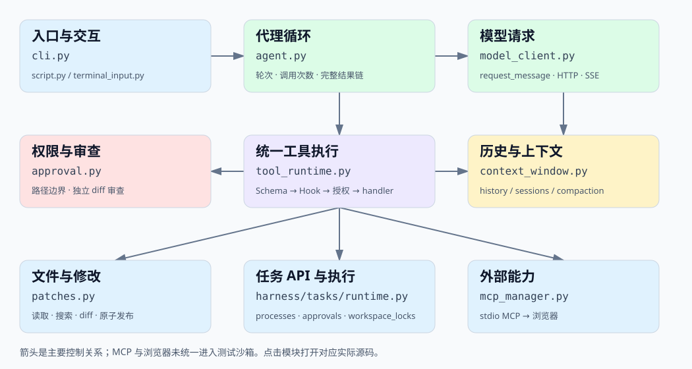

# 从成品读懂 Local AI CLI

这套教程面向已经接触 `input/print`、列表、字典、循环、函数、JSON、文件读写和异常处理，但尚未熟悉类、异步和进程的读者。它依据当前实际源码编写，不把讨论过但未实现的功能算进项目。此时项目是可演示的开发版本，不能将“功能覆盖较多”理解成所有场景都可靠。

你要学会回答三个问题：**一条任务怎样完成？哪个模块负责哪件事？执行权限由谁决定？** 先掌握这三个问题，再研究每个语法细节。

[离线交互导航](index.html)：可搜索文件、函数、职责，点击模块查看源码；无需网络或模型。

[项目架构总览](../ARCHITECTURE.md)：查看当前模块划分和责任边界。

[0.2.0 新机制导读](../PRODUCT_UPGRADE.md)：先学习统一配置、安装入口、离线诊断与多文件变更，再回到原有工具和任务章节。已有文件可用精确文字替换，相关文件可一次审阅；提交失败补偿不等于跨文件原子事务。

新增代码入口为 `harness/configuration.py`、`harness/diagnostics.py` 和 `harness/files/changesets.py`。源码导航可以通过 `.conda-env/bin/python scripts/update_learning_index.py` 刷新；`--check` 只检查是否陈旧，不写文件。

[DeepSeek 接入与实测](../DEEPSEEK.md) 说明最新协议修复和七项真实验收；[架构文档的协议元数据章节](../ARCHITECTURE.md#模型协议元数据和最终消息保存) 解释为什么最终回答仍返回字符串，却另外通过回调保存完整消息。读这一段时可对照 `api_adapter.py`、`agent.py`、`script.py` 和 `web/workflow.py`。

## 阅读顺序

| 顺序 | 文档 | 看完应能解释 |
| --- | --- | --- |
| 1 | [全局结构与文件地图](00-map.md) | 为什么有这么多文件；进程与模块有什么区别 |
| 2 | [Python 语法桥梁](01-python.md) | `self`、`with/yield`、装饰器、回调、`async/await` 等实际用途 |
| 3 | [启动、消息与代理循环](02-agent.md) | 一句话怎样变成模型请求、工具调用和最终回答 |
| 4 | [工具、文件修改与权限](03-tools.md) | 注册表、参数验证、准备、审批、执行、日志怎样组合 |
| 5 | [历史、会话与上下文](04-context.md) | 磁盘历史、当前请求、系统规则与摘要的区别 |
| 6 | [MCP、AGENTS、Skills、Hooks、浏览器](05-extensions.md) | 各自是什么，接入点在哪，能力边界是什么 |
| 7 | [沙箱、PTY、任务与子代理](06-processes.md) | namespace、资源限制、任务状态与子代理审批 |
| 8 | [终端交互与附件](07-terminal.md) | 输入、补全、文件选择、显示与实际执行的关系 |
| 9 | [测试、排错、面试与练习](08-verification.md) | 如何证明做到了；如何沿调用链查问题 |
| 10 | [具体数据手工跟踪](10-traces.md) | 看消息、字典、pending、字节和ref怎样逐步变化 |
| 随查 | [逐文件源码导读索引](09-source-index.md) | 每个文件的职责、函数位置、参数、返回分支与源码 |

建议每读一个章节，只开它指定的两三个源码文件。看到陌生语法先查语法桥梁，再回到原函数。**不必一次读完源码导读。** 它是查阅用的词典。

## 教程与源码的位置

章节里的源码链接是仓库相对路径。离线 HTML 索引从当前 Python 文件生成代码快照，并提供打开实际源码的链接。`source/` 下的逐文件导读和行号快照来自较早结构，作为语法参考保留；重构后的路径和行为以章节中的当前源码链接为准。

源码导读中的“静态调用”来自 Python AST，表示函数体里出现了调用表达式，**不是完整运行时调用图**：回调、字典中的 handler、装饰器、`partial` 和动态 MCP 注册必须结合正文解释。嵌套函数和方法使用限定名称，避免把多个 `main`、`read` 混为一谈。

## 本项目的真实边界

- 模型接入、工具循环、文件搜索修改、历史会话、上下文摘要、终端交互、MCP、项目规则、手动 Skills、可信 Python Hooks、PTY、开发子代理与基础浏览器已实现。
- WSL 的沙箱、MCP、终端及浏览器有真实集成测试；固定任务有真实模型验收。GitHub Actions 验证普通测试，不连接本地模型、不替代宿主集成测试。
- MCP 仅 stdio 的工具发现与调用；没有 HTTP MCP、resources、prompts 完整能力。
- 根目录 AGENTS 有效，子目录规则覆盖未实现。Skills 手动启用，未实现自动语义选择或完整元数据协议。
- Hook 是配置选择的可信 Python 函数；没有外部命令 Hook 系统。
- 子代理是独立可信 worker，可通过统一 Runtime 读取、编辑、新建文件、运行测试和启动 PTY；它没有父聊天上下文、MCP 工具或继续创建子代理的能力，也不是 OS 权限沙箱。测试与 PTY 在只读、禁网 bubblewrap 中，并设置每进程 rlimit；这不构成 cgroup 级任务总量配额。浏览器可联网，不属于测试沙箱。
- 上下文使用字符预算而非精确 token 预算；摘要有损，原历史保留。
- 浏览器单页、短正文与元素 ref，截图不送视觉模型；复杂网页、多页、iframe 等未覆盖。

## 学习时怎么区分三个“你”

1. **你本人**：在终端输入命令或任务。
2. **模型**：返回文字或提出工具调用，是任务规划者。
3. **CLI 程序**：真正打开文件、做权限判断、启动进程，是执行者。

模型说“我允许”没有执行授权效力；程序 `authorize_*` 返回允许后，执行器才调用 handler。这个区别贯穿整套教程。
